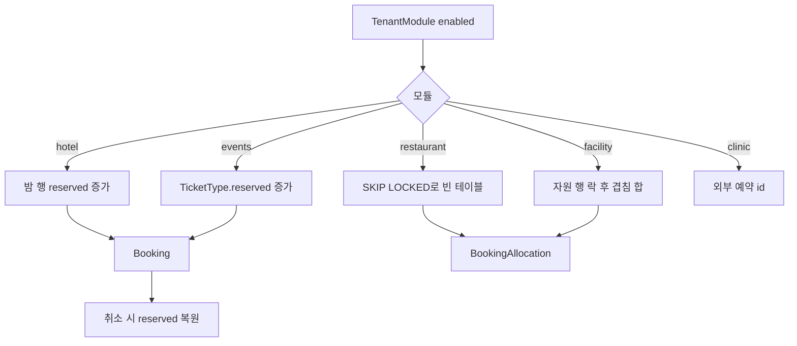

# FastBooking — 모듈마다 할당 전략, 락은 그 재고 행에 건다

소스는 [predictivelabsai/FastBooking](https://github.com/predictivelabsai/FastBooking)다. 체크아웃은 `commerce-study/FastBooking`. Python, FastAPI와 FastHTML, PostgreSQL, Apache-2.0. 커밋 수가 적고 스타가 없다. 운영 레퍼런스라기보다, 모듈을 나눈 예약·판매 스케치로 본다.

상품·재고 모델은 `app/db/platform_models.py`, 식당 메뉴는 `app/db/models.py`, 할당은 `app/services/booking.py`다. `sql/schema.sql`은 메뉴·주문만 있는 예전 SQL이라 호텔·티켓 테이블은 없다. 테넌트가 켠 모듈만 예약을 받는다. 공통 줄은 `Booking`이고, 자리·테이블·시설은 `BookingAllocation`이다.

---

## 모듈

| 모듈 | 잠그는 행 | 가용성 |
|------|-----------|--------|
| restaurant | 수용 인원이 파티 이상인 `table`을 `FOR UPDATE SKIP LOCKED`, 작은 테이블부터 | 겹치는 `BookingAllocation`이 없으면 그 테이블 |
| hotel | `HotelRoomType`과 밤별 `HotelNightInventory`를 `FOR UPDATE` | 반열린 구간 `[check_in, check_out)`. 밤 행이 없으면 `units`와 `nightly_rate`로 만든다. `reserved + rooms`가 `capacity`를 넘거나 `closed`면 거절 |
| events | `TicketType`을 `FOR UPDATE` | `reserved + quantity <= capacity`. 판매 창, 회차 `published`, `max_per_booking` |
| recreation 시설 | `Resource`를 `FOR UPDATE` | 겹치는 allocation 수량 합 + 요청 수량 ≤ `resource.capacity` |
| recreation 프로그램 | 취소 경로에서 `RecreationProgramme` 행 락 | `enrolled` 카운터. 등록 행은 `ProgrammeEnrolment` |
| clinic | FastBooking 재고 행이 아님 | FastClinic HTTP로 예약. `Idempotency-Key`. 409면 그 시각은 없음. 임상 기록은 여기 두지 않는다 |

세는 예약 상태는 `pending`, `confirmed`다. 호텔·티켓·프로그램 취소는 같은 행을 다시 잠그고 `reserved` 또는 `enrolled`을 줄인다. 0 밑으로는 내리지 않는다.

호텔 요금은 밤마다 `rate`가 있으면 그 값, 없으면 룸타입 `nightly_rate`다. 숙박 합이 예약의 `subtotal`이 된다.

---

## 흐름

README는 모듈이 테넌트, 장소, 고객, 예약 참조, allocation, 알림, 결제 원장을 공유한다고 적는다. Stripe가 있으면 hosted Checkout이고, 없으면 시설에서 받는다. 이 노트의 재고 문장은 `booking.py`의 행 락이다.

---

## 지금 레포와 맞추면

- 호텔의 밤별 `capacity` / `reserved`는 QloApps의 방 행×날짜 겹침과 다르다. 룸타입 수량을 날짜마다 둔다. 물리 방 번호는 이 함수에 없다.
- 티켓 `reserved` 증가는 Saleor `quantity_allocated`에 가깝고, pretix처럼 주문 행을 매번 세지 않는다. 취소가 카운터를 되돌린다.
- 식당 테이블의 `SKIP LOCKED`는 alf.io가 빈 티켓 행을 집어 가는 방식과 같다. 잠긴 테이블은 건너뛰고, 맞는 빈 테이블이 없으면 거절한다.
- 클리닉은 재고의 주인이 외부다. Sharetribe `InventoryMode.None`처럼 이 저장소는 거절 코드만 받는다.

가져갈 것: 모듈이 달라도 `Booking`은 하나이고, 락과 복원은 그 모듈의 재고 행이 한다.

가져가지 말 것: 이 저장소의 카운터를 그대로 운영 원장으로 쓰기. 이동 이력 없이 `reserved`만 증감한다. 이력은 Odoo `stock.move`나 Sharetribe adjustment 쪽을 본다.

---

## 질문

### 모듈마다 상품 테이블과 재고 테이블이 다른가

상품 정의는 공통 `offerings`에 모듈 전용 행이 붙는다. 재고는 모듈마다 잠그는 행이 갈라진다. 식당 테이블과 시설만 `resources`와 `booking_allocations`를 같이 쓴다. 옵션 축은 없다. 디럭스와 VIP는 각 모듈의 별도 행이다.

테넌트는 설치본 안의 사업체 한 곳이다. `tenants`에 슬러그, 이름, 상태, 시간대, 통화가 있고, 켠 모듈은 `tenant_modules`다. 한 테넌트가 호텔과 이벤트를 같이 켤 수 있다.

| 모듈 | 상품 테이블 | `offerings`와 관계 | 재고 |
|---|---|---|---|
| 호텔 | `hotel_room_types` | 1:1. 정원, 보유 실 수, 1박 요금 | `hotel_night_inventory`. 룸타입 × 밤의 `capacity` / `reserved`. 상품 행과 재고 행이 분리된 곳은 여기 |
| 이벤트 | `scheduled_events`, `ticket_types` | 회차가 Offering에 달림. 파는 칸은 티켓 타입 | `ticket_types.capacity` / `reserved`. 재고 테이블이 따로 없음 |
| 강좌 | `recreation_programmes` | 강좌가 Offering 하나를 가리킴 | 강좌 행의 `capacity` / `enrolled`. 명단은 `programme_enrolments` |
| 클리닉 | `offerings` + 의사 `resources` | 진료는 Offering. 의사는 `resource_type = practitioner` | 로컬 재고 행 없음. `clinic_connectors`로 FastClinic에 넘김 |
| 시설 | `resources` | Offering은 가격용이라 없어도 됨 | `resources.capacity`와 겹치는 `booking_allocations` 수량 합 |
| 식당 테이블 | `resources` (`resource_type = table`) | Offering을 안 봄 | 시설과 같은 할당. 겹치면 그 테이블은 거절 |
| 회원권 | `membership_plans` | Offering이 아님 | `customer_memberships.visits_remaining`. `bookings`를 만들지 않음 |
| 식당 메뉴 | `products` | 예약 카탈로그와 별개 | 메뉴 행의 `quantity`. 테이블 예약 함수는 이 테이블을 보지 않음 |

호텔 예: 디럭스 `units = 10`. 3월 1일 체크인, 3월 3일 체크아웃, 2실이면 3월 1일·2일 밤 행의 `reserved`만 2씩 오른다. 호수 테이블은 없다.

이벤트 예: 한 회차의 일반권 `capacity = 400`. 2장이면 그 `ticket_types` 행의 `reserved`가 2가 된다.

`app/db/platform_models.py`  
`app/db/models.py` (`products`, `orders`, `order_products`)
