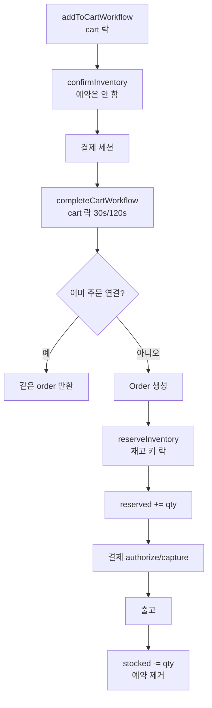

# Medusa 2.20 — 모듈로 쪼갠 헤드리스 커머스

**경로:** `medusa/`  
**버전:** `@medusajs/medusa` 2.20.1  
**스택:** Node.js, TypeScript, MikroORM, PostgreSQL, 워크플로 엔진(Redis 또는 인메모리)

상품·가격·재고·주문·결제가 각각 npm 패키지이고, 패키지끼리 **모듈 링크 테이블**로 붙는다. 비즈니스 절차는 `packages/core/core-flows`의 워크플로가 묶는다.

```
packages/modules/product|pricing|inventory|stock-location|cart|order|payment|fulfillment
packages/modules/link-modules     # variant↔재고, variant↔가격, 채널↔창고
packages/core/core-flows          # 장바구니 완료, 출고, 환불
packages/modules/providers/locking-postgres|locking-redis
```

---

## 상품은 무엇인가

구매 단위는 항상 **ProductVariant**다. Product는 이름·핸들·상태의 그릇이다.

```
Product
  ├── ProductOption (Color, Size)
  │     └── ProductOptionValue (Red, M)
  ├── ProductVariant  ← SKU, 재고 관리 여부, 백오더 허용
  │     ├── link: product_variant_inventory_item (required_quantity)
  │     └── link: product_variant_price_set → Price
  ├── ProductType, ProductCategory(트리), ProductCollection
  └── SalesChannel ── link ── StockLocation
```

| 개념 | 이 코드에서의 의미 |
|------|-------------------|
| 단순 상품 | Product 1 + Variant 1 |
| 옵션 상품 | 옵션 값 조합마다 Variant |
| 키트 | Variant 1개가 InventoryItem 여러 개에 연결. `required_quantity`만큼 재고를 깎음 |
| 기프트카드 | `Product.is_giftcard`. 카드 원장은 loyalty 플러그인 쪽 |
| 디지털 | `InventoryItem.requires_shipping = false`, 필요하면 `manage_inventory = false` |
| 가격 | v1의 MoneyAmount는 삭제됨. `Price.amount`가 금액 |

변형이 재고를 끄면(`manage_inventory = false`) 항상 재고 있음으로 본다. `allow_backorder = true`면 모자라도 주문을 받는다.

모델: `packages/modules/product/src/models/`, `packages/modules/pricing/src/models/price.ts`

---

## 재고

세 층이다.

| 테이블 | 역할 | 핵심 컬럼 |
|--------|------|-----------|
| `inventory_item` | SKU 원장 | `sku` unique |
| `inventory_level` | 창고(location)별 수량 | `stocked_quantity`, `reserved_quantity`, `incoming_quantity`. unique `(inventory_item_id, location_id)` |
| `reservation_item` | 주문 라인에 묶어 둔 홀드 | `line_item_id`, `quantity`, `location_id` |

```
available = stocked_quantity - reserved_quantity
```

`allocated_quantity` 컬럼은 없다. 예약이 소프트 할당이다.

| 시점 | 하는 일 |
|------|---------|
| 장바구니 담기 | `confirmInventory`로 available만 검사. **예약 행은 안 만든다** |
| 주문 확정 `completeCartWorkflow` | `createReservationItems` → `reserved_quantity` 증가 |
| 출고 | `stocked_quantity` 감소, 예약 삭제·감소 |
| 반품 수령 | `stocked_quantity` 증가 |
| 주문 취소 | 라인의 예약 삭제 |

예약 생성 시 `available < 요청 수량`이면 거절한다. 백오더면 이 검사를 건너뛴다.

`packages/modules/inventory/src/services/inventory-module.ts`  
`packages/core/core-flows/src/cart/steps/reserve-inventory.ts`  
`packages/core/core-flows/src/order/workflows/create-fulfillment.ts`

---

## 환불·반품·교환

돈과 물건이 갈라져 있다.

- **Payment / Capture / Refund / RefundReason** — 결제 모듈. 환불은 캡처된 금액을 넘지 못한다.
- **Return** — 반품. `refund_amount`, 수령 위치.
- **OrderClaim**, **OrderExchange** — 클레임·교환. 교환은 `difference_due`.
- **OrderChange** — 반품·교환·주문수정의 상태 그릇. `PENDING → CONFIRMED | DECLINED | CANCELED`. 확정되면 `order.version`이 올라간다.

```
반품 시작 → OrderChange PENDING
  → 반품 확정 → 물건 수령 → stocked 증가
  → 관리자가 refundPaymentWorkflow
       → payment 행 FOR UPDATE
       → Refund 행 생성
       → provider.refundPayment(idempotency_key = refund.id)
       → order_transaction (reference = refund, 금액 음수)
```

전액 환불은 `refundCapturedPaymentsWorkflow`가 결제마다 `captured - 이미 환불`을 계산한다.

`packages/core/core-flows/src/payment/workflows/refund-payment.ts`  
`packages/modules/payment/src/services/payment-module.ts`

---

## 주문 흐름



결제 실패 보상: 승인만 됐으면 취소, 캡처됐는데 주문이 없으면 환불. 같은 cart에 주문이 이미 있으면 그 주문을 돌려준다.

---

## DB에서 볼 테이블

| 묶음 | 테이블 |
|------|--------|
| 카탈로그 | `product`, `product_variant`, `product_option`, `product_option_value`, `product_category` |
| 링크 | `product_variant_inventory_item`, `product_variant_price_set`, `sales_channel_stock_location` |
| 재고 | `inventory_item`, `inventory_level`, `reservation_item` |
| 주문 | `order`(`version`), `order_item`(`version`), `order_line_item`, `order_change`, `return`, `order_claim`, `order_exchange`, `order_transaction` |
| 결제 | `payment_collection`, `payment`, `capture`, `refund`, `refund_reason` |
| 가격 | `price_set`, `price` |

`inventory_level`은 `(inventory_item_id, location_id)` 부분 유니크(soft delete 제외). variant의 `sku`, `barcode`, `ean`, `upc`도 유니크.

---

## 락

| 대상 | 방법 |
|------|------|
| 재고 예약·조정 | 재고 아이템 id로 `pg_advisory_xact_lock` 또는 Redis `SET NX`. **inventory_level 행 FOR UPDATE는 없다** |
| 장바구니 완료 | `acquireLockStep(cart_id)` |
| 환불 | `SET LOCAL lock_timeout = '3s'` 후 `payment` 행 `FOR UPDATE`. 락 안에서 캡처·기존 환불을 다시 읽음 |
| 프로모션 | `promotion`, `promotion_campaign_budget`을 id 순 `FOR UPDATE` |
| 주문 수정 | `order.version` 낙관적 스냅샷 |

카트 단계에는 재고 락이 없어서, 두 사람이 마지막 재를 같이 담을 수 있다. 막는 지점은 **주문 확정의 재고 키 락 + available 검사**다.

`packages/modules/providers/locking-postgres/src/services/advisory-lock.ts`

---

## 이 코드에서 가져갈 것

- 가격·재고·주문을 테이블로 직접 묶지 않고 링크 테이블로 떼었다. 모듈 DB를 따로 둘 수 있다.
- 재고 수명주기: **검사(카트) → 예약(주문) → 차감(출고) → 복원(반품 수령)**.
- 돈의 동시성은 행 락, 재고의 동시성은 advisory/Redis 락으로 역할을 나눴다.

---

## 질문

### 상품은 어떤 테이블로 정의되는가

Saleor의 attribute 층은 없다. 상품, 옵션, 옵션 값, variant다. variant가 판매 단위다.

| 테이블 | 셔츠를 색·사이즈로 팔 때 |
|--------|--------------------------|
| `product` | 이름·설명·상태 1행 |
| `product_option` | 색, 사이즈 |
| `product_option_value` | 빨강, 파랑, S, M |
| `product_product_option` | 이 상품이 그 축을 쓴다 |
| `product_variant` | 빨강·M이 SKU 1개 |
| `product_variant_option` | 그 variant가 빨강과 M을 고름. 옵션 수만큼 |

빨강·M 하나의 새 연결은 variant 1행과 `product_variant_option` 2행이다. `ProductType`은 “셔츠” 같은 이름표이고 옵션 스키마가 아니다. 소재는 `product.material` 컬럼이다.

가격은 variant 행에 없다. variant가 `price_set`에 연결되고 `price`가 통화와 금액을 담는다. 가격 줄을 나누는 것은 채널이 아니라 통화, 수량 구간, `price_list`다. 판매 채널은 그 창구에 이 상품을 공개할지의 연결이다.

### 재고는 variant에 바로 붙나

아니다. 창고는 `StockLocation`이다. 수량은 `inventory_level`에 있고, 한 줄은 재고 항목 × 창고다. Saleor의 Stock(창고 × variant)과 같은 자리다.

```text
ProductVariant → InventoryItem → InventoryLevel → StockLocation
SalesChannel → StockLocation
```

variant와 재고 항목은 `product_variant_inventory_item` 링크다. 창고가 둘이면 `inventory_level`이 2줄이고, 판매 채널이 서울만 연결하면 가용 수는 서울 줄만 본다.

### variant와 재고 항목은 어떻게 이어지나

N:N은 variant와 수량 칸이 아니라 variant와 `InventoryItem`이다. 수량은 그 항목의 창고별 `inventory_level`에 있고, `(inventory_item, location)`은 한 줄이다. `stocked_quantity`와 `reserved_quantity`가 그 칸에 있다.

링크 테이블은 `product_variant_inventory_item`이다. `variant_id`, `inventory_item_id`, `required_quantity`가 한 줄이고, `required_quantity` 기본값은 1이다. 선언은 `packages/modules/link-modules/src/definitions/product-variant-inventory-item.ts`의 `extraFields`다. variant에도 inventory item에도 이 컬럼은 없다.

| 연결 | 결과 |
|------|------|
| variant 1개, inventory item 1개 | 기본. 창고가 둘이면 `inventory_level` 2줄 |
| inventory item 1개에 variant 여러 개 | 그 칸의 수량을 같이 씀. M을 예약하면 L의 가용량도 줄어듦 |
| variant 1개에 inventory item 여러 개 | 키트. 주문 수량 × `required_quantity`만큼 각 부품을 예약 |

키트는 상품 종류나 variant 컬럼이 아니다. 관리 화면의 `inventory_kit`은 저장되지 않는 체크박스이고, 설정은 variant에서 한다. `manage_inventory`가 켜진 variant에 링크를 여러 줄 붙인다. 목록을 비우면 워크플로가 inventory item을 하나 만들고 `required_quantity` 1로 잇는다. 같은 variant에 같은 inventory item을 두 번 잇는 것은 거절된다. 만드는 코드는 `packages/core/core-flows/src/product/workflows/create-product-variants.ts`의 `buildLink`다.

선물 세트 1개에 병 2개와 상자 1개가 필요하면 링크는 두 줄이다. 병 `required_quantity` 2, 상자 1. 세트 variant에는 `stocked_quantity`가 없고, 세트 1개를 팔면 병은 2, 상자는 1이 예약된다. 출고 때 각 `stocked_quantity`도 그 곱한 수량만큼 줄어든다. 병 inventory item을 다른 variant에도 걸면 그 재고를 같이 쓴다.

### 선점은 언제이고, 판매 가능 수는 어떻게 계산하나

장바구니에 담을 때는 선점하지 않는다. `confirmInventory`가 숫자만 보고 `reservation_item`은 만들지 않는다. 그래서 마지막 1개를 두 사람이 같이 담을 수 있다. 막는 지점은 주문 확정 `completeCartWorkflow`의 `reserveInventory`다. 재고 아이템 락을 잡고 available을 다시 계산해, 요청보다 작으면 거절한다.

```text
칸의 available = stocked_quantity - reserved_quantity
팔 수 있는 수 = 그 채널 창고들의 available 합
```

`stocked_quantity`가 Saleor의 `Stock.quantity`에 해당하고, 주문 할당과 체크아웃 예약을 나눈 자리는 `reserved_quantity` 하나다. 체크아웃 예약 줄이 없으므로 “내 예약은 빼고 계산”하는 단계는 없다. 주문 확정에 성공하면 `reservation_item`이 생기고 `reserved_quantity`가 오른다. 출고 때 `stocked_quantity`가 줄고 그 예약은 삭제된다.

### `order`, `order_item`, `order_line_item`은 어떻게 다른가

`order`는 헤더다. 고객, 통화, 판매 채널, 상태, 주소, `version`. 상품 이름과 수량은 없다.

`order_line_item`은 판매 당시 상품 스냅샷이다. 제목, `variant_id`, SKU, 옵션 값, 단가. 수량과 출고 상태는 없다. 카탈로그를 나중에 고쳐도 이 줄은 바뀌지 않는다.

`order_item`은 그 스냅샷을 이 주문에 붙인 수량이다. `item_id`로 스냅샷을 가리키고, `quantity`, 출고·배송·반품 수량, 단가, `version`이 있다. 주문을 고치면 `order.version`과 함께 `order_item`이 버전별로 쌓이고, 스냅샷은 그대로 둔다.

셔츠 M 2장이면 헤더 1, 스냅샷 1, 수량 줄 1이다.

### 판매자는 줄마다 있나

없다. `order_line_item`, `product`, `product_variant`에 판매자 컬럼이 없다. 줄을 나누는 것은 스냅샷의 상품이다. `sales_channel_id`는 주문 헤더에 하나이고, 다른 판매자가 아니라 같은 가게의 웹·앱 같은 창구다.

코어는 판매자 한 명의 쇼핑몰이다. `store`가 그 가게 설정 한 줄이다. 창고가 여러 개인 것은 그 판매자의 재고 위치다. 판매자 모듈은 이 패키지들에 없다.
