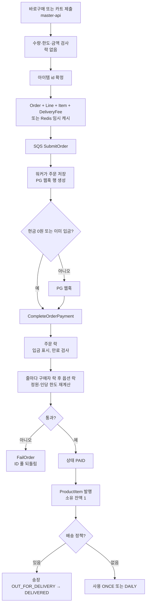

# Talket — 옵션 정원을 결제 확정 때 합산한다

**경로:** `camellia-main-server` (이 워크스페이스 밖)  
**스택:** Node.js, TypeScript, NestJS, TypeORM, MySQL, Redis, SQS

티켓과 굿즈를 한 주문 모델로 판다. 클래스 이름은 아직 `Nft*` 이고, 테이블과 계약(contract) 이름은 `Product` / `Order` 로 바뀌어 있다. 이 문서는 지금 이름을 쓴다.

```
packages/wallet     상품, 옵션, 아이템, 소유, 카트, 사용
packages/trade      주문, 라인, 아이템, 배송, 클레임, 환불
packages/payment    PG 웹훅
packages/form       구매자 정보 폼
apps/master-api     구매 HTTP
apps/master-command-worker   SQS 워커
apps/admin, apps/partner-api
```

| 지금 이름 | 코드 클래스 | 테이블 |
|-----------|-------------|--------|
| Product | `NftCollection` | `t_product` |
| ProductOption | `NftPublicSale` | `t_product_option` |
| ProductItem | `Nft` | `t_product_item` |
| ProductUsage | `NftCollectionBenefit` | `t_product_usage` |
| Order | `NftTrade` | `t_order` |
| OrderLine | `NftTradeSale` | `t_order_line` |
| OrderItem | `TradeSaleUnit` | `t_order_item` |
| OrderRefund | `TradeRefund` | `t_order_refund` |

---

## 상품은 무엇인가

사는 단위는 **ProductOption**이다. Product는 이름·판매 기간·정책의 그릇이고, 가격과 정원은 옵션에 있다. 옵션은 색×사이즈 조합이 아니다. “VIP”, “일반”, “S”처럼 **이름 붙은 판매 칸**이고, 칸마다 가격·정원·인당 한도가 따로다.

```
Product                         카테고리, 판매 기간, 배송·환불·확정 정책
  ├── ProductOption             이름, 가격, totalCount, min/maxOrderLimit
  ├── ProductContent            전시 스키마 goods.v1 | ticket.v1
  ├── ProductUsage              소유한 아이템으로 할 수 있는 일
  ├── ProductThumbnail, DeliveryPolicy
  └── (결제 후) ProductItem     수량 1개 = 행 1개. 주문 제출 때 id를 미리 정함
        └── ProductItemOwnership   잔액. 발행 때 1
```

| 개념 | 이 코드에서의 의미 |
|------|-------------------|
| 카테고리 | `ETC`, `TICKET`, `RESERVED_SEAT_TICKET`, `MEMBERSHIP`, `PACKAGE`, `GOODS`, `SHIPPING` |
| 전시 | `ticket.v1`은 공연·입장, `goods.v1`은 수령·상품정보. `seatMetaUrl`은 좌석 메타 파일 주소 |
| 사용 | `ProductUsage` 카테고리 `TICKET`, `VOUCHER`, `PICKUP`, `PURCHASE_ENTITLEMENT`, `VOTE`, `USE`. 횟수는 `ONCE` 또는 `DAILY` |
| 판매 묶음 생성 | `CreateProductBundle`은 상품·옵션·사용·콘텐츠를 한 번에 만드는 명령이다. 구성품 재고를 깎는 번들이 아니다 |
| 진열 그룹 | `ProductGroup`은 파트너 화면의 묶음이다. 재고와 가격이 없다 |
| 지급 | `ProductDistribution`(에어드롭)은 결제 없이 같은 발행 경로로 아이템을 넣는다 |
| 구매 제한 | 옵션의 `allowedPartnerId` / `allowedPartnerGroupId`. 승인된 파트너 멤버만 산다 |
| 지정석 | 카테고리와 메타 URL은 있다. 좌석 행을 잠그는 재고 테이블은 없다. 정원은 옵션 `totalCount`다 |

상품 생성 시 기본 환불 정책은 `NO_REFUND`다. `GENERAL`로 바꿀 수 있다. 클레임 마감과 구매 확정은 기간(ms)과 고정 시각 중 **더 이른 쪽**을 쓴다.

`packages/wallet/src/domain/aggregates/NftCollection/NftCollection.ts`  
`packages/wallet/src/domain/aggregates/NftPublicSale/NftPublicSale.ts`  
`packages/contract/src/product/models/ProductContentDisplay.ts`

---

## 재고

옵션에 정원 숫자 `totalCount`가 있다. 팔린 수의 기준은 컬럼이 아니라 주문 줄 합이다.

```
남은 수 = totalCount
        - SUM(order_line.current_quantity)
          WHERE state IN (VERIFIED, PAID, PAID_PARTIAL_CANCELED)
```

`SUBMITTED`, `PENDING`, `FAILED`, `PAID_CANCELED`는 빠진다. 카트와 미결제 주문은 DB 재고를 잡지 않는다. `totalSalesCount`는 결제 뒤에 같은 합으로 다시 쓰는 표시용 숫자다.

| 시점 | 하는 일 |
|------|---------|
| 장바구니 | 수량만 저장. 재고 행을 만들지 않음 |
| 바로구매·카트 주문 제출 | 수량 합을 락 없이 한 번 본다. 동시에 마지막 재를 같이 통과할 수 있다 |
| 결제 완료 | 옵션 락 안에서 합을 다시 계산하고, 모자라면 주문을 `FAILED`로 보낸다 |
| 부분 취소 | `current_quantity`가 줄고, 다음 합에서 그 수량이 빠진다 |
| 전량 취소 | 줄 상태가 `PAID_CANCELED`가 되어 합에서 빠진다 |

핫패스용 Redis ID 풀이 따로 있다. 관리자가 옵션마다 UUID를 `count`개 넣어 켠다. **바로구매**이고 옵션에 `maxOrderLimit`이 있으며 풀이 켜져 있을 때만 `LPOP`으로 id를 꺼낸다. 카트 주문과 한도가 없는 옵션은 UUID를 그때 만든다. 결제 실패 시 꺼낸 id는 버리고 **새 UUID**를 풀에 되돌린다. 결제된 뒤의 취소는 이 풀에 되돌리지 않는다. 풀이 비면 DB에 여유가 있어도 바로구매는 품절로 끝난다.

`packages/trade/src/infrastructure/mysql/domain/MySqlNftTradeSalePaidQuantityFetcher.ts`  
`packages/trade/src/domain/command-models/NftTradeStockValidator/NftTradeStockValidator.ts`  
`packages/trade/src/infrastructure/redis/RedisTradeNftIdCache.ts`  
`apps/admin/src/application/product/controllers/ProductOptionCacheController.ts`

---

## 환불·클레임

돈, 주문 수량, 소유 잔액이 갈라져 있다.

- **Claim** — `CANCEL`, `CANCEL_REQUEST`, `RETURN`. 책임은 `SELLER` 또는 `BUYER`. 상태 `SUBMITTED → WAITING → PARTIAL_COMPLETED | COMPLETED`.
- **OrderRefund** — 클레임 결정에서 나온다. `SUBMITTED → WAITING → REFUNDED | FAILED`. 상품 금액·배송비·현금·포인트를 나눈다.
- **ProductItem 회수** — 대기 단계에서 소유 이력 `CLAIM_RETRIEVED`를 남기고 잔액을 갱신한다. 아이템 행은 지우지 않는다.

```
클레임 제출 → 수락
  → 주문 아이템·배송비에 claimProcessId
  → OrderRefund 생성
  → 아이템 회수 (소유 잔액)
  → PG 환불 확정
  → 주문 줄 currentQuantity 감소
       전량이면 PAID_CANCELED, 일부면 PAID_PARTIAL_CANCELED
```

배송비 환불은 `t_delivery_fee_refund`로 줄 환불과 따로다. 구매 확정(`confirmedAt`)과 클레임 마감은 주문 아이템에 스냅샷된다.

`packages/trade/src/domain/aggregates/Claim/Claim.ts`  
`apps/master-command-worker/src/application/trade/processors/StartClaimAcceptCommandProcessor.ts`  
`apps/master-command-worker/src/application/trade/processors/StartClaimWaitingCommandProcessor.ts`

---

## 주문 흐름

한 주문은 헤더 + 옵션별 줄 + 수량만큼의 아이템이다. 아이템 id가 곧 나중에 발행될 ProductItem id다. 줄에는 상품명·옵션명·단가·한도가 복사된다.

입구는 둘이다.

| | 바로구매 | 카트 |
|--|----------|------|
| 담는 범위 | 같은 Product의 옵션 여러 개 | 카트에 있는 여러 Product |
| 아이템 id | 한도가 있고 ID 풀이 켜져 있으면 풀에서 | 항상 새 UUID |
| 카트 줄 | `cartable`이면 주문과 함께 카트에도 넣음 | 이미 있는 `cartItemId`를 줄에 연결 |

제출 시 만료는 2일이다. 결제 수단이 `DIRECT_DEPOSIT`면 시작 상태가 `PENDING`, 그 외는 `SUBMITTED`다.



결제 완료 처리(`CompleteNftTradePaymentCommandProcessor`)는 주문 락을 여러 번 잡는다. 줄 검증이 품절·한도 초과·시간 초과면 보상으로 `FailOrder`를 보낸다. 이미 `PAID`면 발행을 다시 하지 않도록 발행 프로세서는 아이템 존재 여부로 멱등하다.

이행은 카테고리로 갈라진다. 티켓·멤버십은 소유와 `ProductUsage`다. 배송 정책이 있는 상품은 주소가 필수이고, 배송비는 파트너·정책·도서산간 우편번호로 `PriceCalculator`가 묶는다. 정책 유형은 `NONE`, `BUNDLE`, `PER_QUANTITY`, `FREE`, `FIXED`, `AMOUNT_TIERED`다.

`apps/master-api/src/application/trade/processors/SubmitNftTradeBuyNowCommandProcessor.ts`  
`apps/master-api/src/application/trade/processors/SubmitNftTradeFromCartCommandProcessor.ts`  
`apps/master-command-worker/src/application/trade/processors/CompleteNftTradePaymentCommandProcessor.ts`  
`apps/master-command-worker/src/application/wallet/processors/IssuePublicSaleNftCommandProcessor.ts`

---

## DB에서 볼 테이블

| 묶음 | 테이블 |
|------|--------|
| 카탈로그 | `t_product`, `t_product_option`, `t_product_content`, `t_product_thumbnail`, `t_product_usage`, `t_product_group`, `t_product_group_item` |
| 배송 정책 | `t_product_delivery_policy`, `t_bundle_delivery_policy` |
| 카트 | `t_cart`, `t_cart_item` (`is_paid`) |
| 주문 | `t_order`, `t_order_payment`, `t_order_line`, `t_order_item`, `t_delivery_fee`, `t_delivery`, `t_delivery_address` |
| 소유 | `t_product_item`, `t_product_item_ownership`, `t_product_item_ownership_history`, `t_product_usage_history` |
| 클레임 | `t_claim`, `t_claim_item`, `t_claim_decision`, `t_claim_fee`, `t_order_refund`, `t_order_item_refund`, `t_delivery_fee_refund` |
| 결제 | `t_payment_webhook`, `t_payment_webhook_event` |

주문 상태: `SUBMITTED → PENDING | VERIFIED → PAID → PAID_PARTIAL_CANCELED | PAID_CANCELED`, 또는 `FAILED`.  
주문 아이템 상태: `SUBMITTED → PAID → PAID_CANCEL_REQUESTED → PAID_CANCELED`.  
배송 상태: `OUT_FOR_DELIVERY → DELIVERED | CANCELED`.

---

## 락

| 대상 | 방법 |
|------|------|
| 옵션 재고 재검증 | Redis가 있으면 `lock:public-sale:{optionId}` 7초. 없으면 MySQL `GET_LOCK('sale_{optionId}', 600)` |
| 인당 한도 | 구매자 `GET_LOCK` 후 그 안에서 옵션 락 |
| 주문 상태 전이 | 주문 id `GET_LOCK` |
| ID 풀 | `lock:trade:nft-ids-cached:{optionId}:{buyerId}` 7초. 그 안에서 `LPOP` |
| 클레임 | 클레임 id, 주문 id, 배송비 id를 각각 named lock |

재고의 기준 전이는 결제 완료의 **구매자 락 → 옵션 락 → 합산**이다. 제출 시점 검사는 그 락 밖에 있다. ID 풀은 그 앞단의 선점이고, 결제된 수량의 원장이 아니다.

`packages/trade/src/infrastructure/composite/CompositeNftPublicSaleLocker.ts`  
`packages/trade/src/domain/commands/VerifyNftTradeSalePayableCommandHandler.ts`  
`packages/base-infrastructure/src/typeorm-extension/TypeOrmNamedLocker.ts`

---

## 이 코드에서 가져갈 것

- 파는 칸은 옵션이고, 결제 후에야 수량만큼 아이템 행이 생긴다. 아이템 id는 주문 제출 때 정해 두어 발행이 멱등하다.
- 재고 원장은 주문 줄 합이다. 잡는 시점은 결제 완료이고, 카트는 수량을 기억만 한다.
- 티켓과 굿즈가 같은 Order / OrderLine / OrderItem을 쓴다. 갈라지는 곳은 배송 정책, 콘텐츠 스키마, 사용 횟수다.
- 핫패스 선점(Redis ID 풀)과 결제 시점 합산이 따로라, 취소분은 DB에만 돌아온다.
