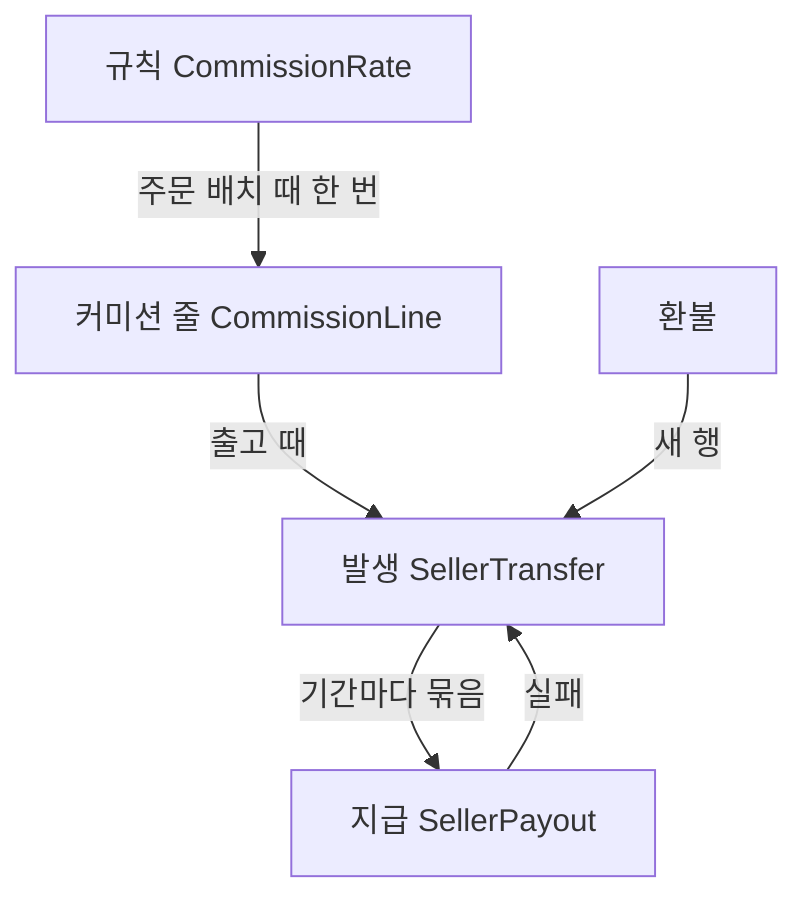
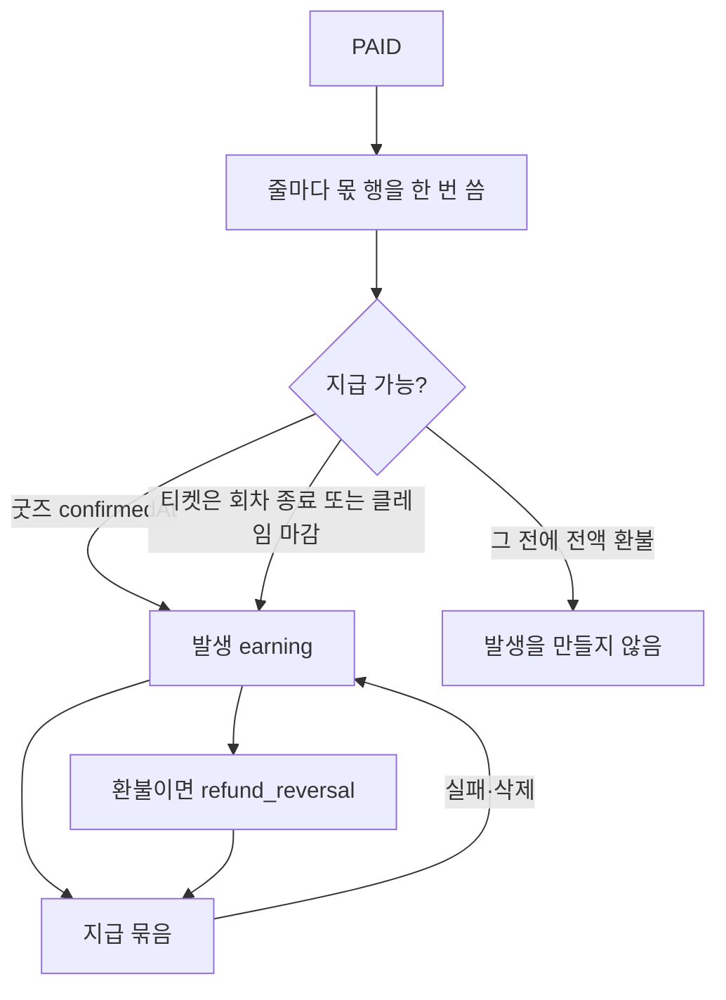

# 정산 — 받은 돈을 나누는 원장

상품·재고·환불·락은 [../README.md](../README.md)다. 한 주문의 캡처를 줄마다 나누겠다는 결정은 [../한-커머스로-모으기-v2.md](../한-커머스로-모으기-v2.md) 8절에 있다. 이 문서는 그 결정을 **어느 레포의 테이블로 올릴지** 정한다.

정산은 결제(capture)도 환불(refund)도 아니다. 구매자가 이미 낸 금액을, 누구에게 얼마를 줄지 적고, 그 기록을 고치지 않은 채 나중에 보내는 일이다. 재고 커밋이 실패해도 이 원장을 되돌리지 않고, 이 원장이 실패해도 재고를 되돌리지 않는다.

---

## 요구사항

커머스 정산이 공통으로 닫는 질문을 먼저 적고, 톡켓이 그 중 무엇을 고정하는지 뒤에 적는다. 세금은 구매자 매출과 수신자 사이 지급이 다른 공급이라 따로 둔다. 아래 절은 이 요구를 어느 레포의 테이블로 닫는지다.

### 공통

- 구매자 캡처 하나를 수신자 여럿의 몫으로 나눈다. 수신자마다 결제를 만들지 않는다.
- 규칙은 다음 판매만 바꾼다. 이번 판매의 몫은 얼린다.
- 몫(약속), 발생(지금 빚), 지급(송금 묶음)은 다른 기록이다. 환불과 정정은 새 행이다.
- 발생은 결제 즉시가 아니다. 환불 창이 닫히거나 인수된 뒤에 생긴다. 그 전에 전액 환불이면 발생이 없다.
- 부분 환불은 그 줄만 역분개한다. 배송비, 취소 수수료, 결제 수수료는 상품 금액과 다른 돈이다.
- 지난 기간의 잔액은 불변 행의 합이다. 지금 주문 상태를 다시 읽어 답하지 않는다.
- 지급은 수신자, 기간, 통화로 묶고, 어느 발생이 들어갔는지 가리킨다. 실패하면 묶음만 풀고, 송금됐는지 모르면 다시 보내지 않는다. 순액이 0 이하이거나 최소액 미만이면 다음 기간과 상계한다.
- 같은 결제·환불 이벤트가 다시 와도 몫, 발생, 역분개, 지급 묶음은 한 번이다.
- 포인트·스토어 크레딧으로 냈다는 이유만으로 수신자 채권을 줄이지 않는 것이 기본이다. 줄일 거면 규칙에 적는다. 원장을 결제 수단별로 복제하지 않는다.
- PG·카드 수수료는 수신자 몫과 다른 칸이다.
- 정산 기록이 실패해도 결제와 재고는 그대로다.

### 톡켓

- 캡처는 주문에 하나이고 주문은 쪼개지 않는다. 한 줄의 수신자는 주최, 아티스트, 플랫폼, 업체, 위탁사, 송출사, 여행사 중 여럿이다. 플랫폼도 수신자 행 하나다. 한 줄의 몫 합은 그 줄의 이번 결제액과 같다.
- `Product.partnerId`는 카탈로그 주인이다. 몫의 수신자는 판매 시점의 규칙 묶음을 복사한다.
- 굿즈 발생은 구매 확정 `confirmedAt`이다. 티켓·시청·멤버십은 회차 종료와 클레임 마감 중 이른 쪽이다. 티켓을 발행한 시각은 발생이 아니다.
- 배송비는 `t_delivery_fee`를 대상으로 한 몫이다. 환불의 입구는 `OrderRefund`와 `t_delivery_fee_refund`다. 원장은 그 다음에 쓴다.
- 포인트로 낸 금액도 기준에 넣는다. 현금·포인트 비율은 결제와 환불에 이미 있다.
- 통화는 KRW 하나다. 통화를 섞어 합산하지 않는다.
- 일수 취소 수수료는 아직 없다. 줄 정책으로 생기면 구매자가 덜 돌려받는 금액이고, 수신자 역분개는 돌려준 상품 금액 기준이다. `ClaimFee`는 반품비 같은 클레임 청구라 이 수수료가 아니다.
- 첫 지급은 송금하지 않는다. 운영자가 기간 합과 담긴 줄을 보고 이체한다. 파트너 화면도 그 둘이다.

### 세금

구매자 결제액의 부가세, 플랫폼 수수료의 부가세, 수신자에게 나눈 돈의 세금계산서·원천징수는 세 공급이다. 한 칸에 넣지 않는다. 주문·상품에 세율 칸은 아직 없다. `PartnerBusiness`에는 상호, 대표, 주소, 사업자번호, 등록증이 있고, 나중에 고칠 수 있다. 개인·원천징수 구분은 없다.

- 구매자 공급은 줄마다 공급자가 한 명이다. 주최가 될 수도 있고 플랫폼이 될 수도 있다. 수신자 여럿이 구매자에게 각각 세금계산서를 내지 않는다. 가격은 부가세 포함이 기본이라, 결제액에서 공급가액과 세액을 나눈다. 세율과 과세·면세·영세는 판매 시점에 얼린다.
- 플랫폼 수수료는 플랫폼이 수신자에게 하는 용역이다. 구매자 부가세와 칸을 나누고, 구매자 합계에 더하지 않는다. 수수료가 플랫폼 수신자 행이면 그 행에 공급가액과 세액을 같이 얼린다. 세금계산서는 플랫폼이 그 수신자에게 끊는다.
- 주최가 아티스트, 송출사, 위탁사에 나누는 돈은 구매자 매출이 아니다. 수신자가 사업자면 그 수신자가 지급 주체에게 끊는 세금계산서(매입)이고, 사업자가 아니면 원천징수다. 세전 몫과 원천세는 둘 다 행으로 남긴다. 원천세를 몫 비율에서 슬쩍 빼지 않는다.
- 계산서에 찍을 상호와 사업자번호는 발행 때 복사한다. `PartnerBusiness`를 나중에 고쳐도 이미 발행한 계산서는 바뀌지 않는다.
- 환불은 구매자 공급의 세액도 역분개한다. 이미 발행한 세금계산서의 정정은 새 문서다.
- 신고 파일, 홈택스 전송, 계정과목은 1차가 아니다. 원장이 공급가액, 세액, 세율, 공급자, 공급받는자를 갖고, 세금계산서와 원천징수 영수증은 그 행을 내보낼 때 만든다. 구매자 현금영수증과 카드 전표는 PG가 가진다.
- 포인트 결제분을 부가세 과세표준에 넣을지는 규칙으로 정한다. 정하기 전에는 원장을 포인트 장부와 현금 장부로 쪼개지 않는다.

---

## 1. 플랫폼이 나눈 네 기록

이름을 통일하면 이렇다. 한 테이블에 넷을 넣은 곳이 학습할 반례다.

| 기록 | 하는 일 | 고쳐도 되는가 | Spree |
|------|---------|----------------|-------|
| 규칙(rule) | 다음에 팔리는 판매의 비율·정액 | 예. 과거 판매에는 안 닿음 | `CommissionRate` |
| 커미션 줄 | 이번 판매에서 플랫폼이 뗀 수수료 | 아니오. 배치 때 얼림 | `CommissionLine` |
| 발생(accrual) | 지금 판매자에게 빚진 금액 | 아니오. 환불은 새 행 | `SellerTransfer` |
| 지급(payout) | 발생 중 보낼 수 있는 것을 묶어 송금 | 실패하면 묶음만 풀고, 발생은 남김 | `SellerPayout` |

`CommissionLine`은 “누가 얼마를 가지는지”가 아니다. 플랫폼 수수료 한 줄이고, 판매자 채권은 출고 때 `판매액 − 커미션 합`으로 발생 행에 계산된다. 톡켓의 몫은 이 줄을 수신자 분할로 다시 만든 것이다. 플랫폼도 수신자 행 하나이고, 한 줄의 합은 그 줄의 결제액과 같다.

구매자가 보는 청구(fee)는 이 넷이 아니다. pretix `OrderFee`와 Spree `Fee`는 주문 합계에 더해지는 배송비·결제 수수료·취소 수수료다. Spree는 수수료와 정산을 일부러 다른 모델로 둔다. 수수료는 구매자 돈이고, 커미션은 플랫폼과 판매자 사이의 돈이라 주문 합계에 넣지 않는다.

---

## 2. 레포가 실제로 만든 구조

### A. 네 기록 (Spree 6)

마켓플레이스 정산이 코드로 있는 곳은 이 클론뿐이다. 모델 주석이 설계다.

`spree/core/app/models/spree/commission_line.rb`  
`spree/core/app/models/spree/seller_transfer.rb`  
`spree/core/app/models/spree/seller_payout.rb`  
`spree/core/app/services/spree/commissions/commission_order.rb`  
`spree/core/app/subscribers/spree/seller_transfer_subscriber.rb`

**규칙.** `CommissionRate`는 스토어의 목록이다. 규칙이 없는 비율이 전체 기본값이고, 목록 맨 아래에 있어야 한다. 그 아래는 닿지 않는다. 해상도는 목록 순서의 첫 매치다. 상품이 카테고리보다 이긴다는 점수는 없다. 시드는 마켓 기본값 하나만 넣고 맨 아래로 내린다. 상품·카테고리·판매자 자리는 시드하지 않는다. 규칙이 없는 빈 비율은 모든 판매에 맞아 아래를 죽이기 때문이다. 새 비율은 목록 맨 위에 들어간다. `docs/user/vendors/commission-rates.mdx`의 “상품 > 판매자 > 기본값, 더 구체적인 규칙이 이긴다”는 이 목록이 아니다. 벤더 프로필과 상품 Platform Fee 칸을 말하는 다른 설명이고, 개발자 문서는 목록 순서만 인정한다. 비율을 고치면 다음 판매만 바뀐다.

**커미션 줄.** 주문 배치(`order.placed`) 때 `CommissionOrder`가 줄을 쓴다. 이미 있으면 다시 계산하지 않고 합계만 맞춘다. 줄 아이템·이행마다 유니크 인덱스가 있어 재전달이 두 번 청구하지 못한다. 이 행은 플랫폼이 그 줄에서 떼는 수수료다. 수신자 분할이 아니다. 판매자는 줄의 `seller_id` 스냅샷이다. 지금 상품 주인이 아니다. 판매자가 없는 줄은 마켓 자신의 상품이라 커미션이 없다. 금액·세액·세율·적용 비율이 행에 복사된다. 커미션 부가세는 상품 부가세와 다른 공급(플랫폼이 판매자에게 청구)이라 칸을 나눈다. 주문에 올라가는 `commission_total`은 그 합의 캐시이고, 구매자 합계에는 안 들어간다.

**발생.** `order.fulfilled`를 받는 구독자가 `SellerTransfer`를 만든다. 비동기다. 송금 HTTP를 출고 트랜잭션 안에 두지 않기 위해서다. 디지털 주문은 이행이 즉시라 바로 발생한다. 금액은 그 주문의 판매액에서 커미션 합을 뺀 값이고, 주문당 하나다. 유니크는 `kind = earning`인 `order_id`다. `order.seller_id`가 없으면 쓰지 않는다. 판매자 주문으로 쪼갠 뒤의 키라, 줄 단위 원장에 그대로 쓰면 한 주문의 두 번째 줄이 거절된다. 스토어 크레딧·기프트카드로 냈는지는 보지 않는다. 판매자 채권을 그 결제 수단만큼 줄이지 않는다. 그 대금은 플랫폼이 댄다. 종류는 `earning`과 `refund_reversal`뿐이다. 환불은 기존 행을 고치지 않고 음수 행을 하나 더 쓴다. 환불당 하나만 유니크다. 줄마다 키가 아니다. 되돌릴 수 있는 금액은 원래 발생에서 이미 되돌린 합을 빼고, 0 아래로 내려가지 않는다.

**지급.** 발생 행의 `payout_id`가 비어 있고 상태가 `completed`인 것만 다음 정산에 담긴다. 지급은 판매자·기간·금액이고, 어떤 발생을 묶었는지 행이 가리킨다. 이미 닫힌 지급 뒤에 도착한 환불 역분은 다음 기간으로 간다. 지급을 지워도 발생은 남고, `payout_id`만 풀려 다음 주기에 다시 담긴다. 실패한 지급이 스탬프를 안고 있으면 그 발생은 영영 안 보인다. 풀지 않는 것이 버그다.

상태는 상태 기계가 아니다. `pending`, `processing`, `completed`, `failed`, `unresolved`. `fail!`은 발생의 `payout_id`를 푼다. `unresolve!`는 풀지 않는다. `unresolved`는 결제사가 돈이 움직였는지 답을 못 한 상태라 재시도하지 않는다. 다시 물어 두 번 보내는 길을 막는다. 돈을 실제로 보내는 일은 `PayoutProvider`다. 기본 구현은 기록만 하고 운영자가 송금한다. Stripe Connect는 그 포트의 한 구현이다.

가져갈 것: 규칙 / 커미션 줄 / 발생 / 지급을 네 기록으로 나누고, 환불은 역분개로만 하고, 지급 실패는 묶음만 푼다. `unresolved`는 묶음을 풀지 않는다.

가져가지 말 것: 판매자마다 주문을 쪼개는 것. `SplitBySeller`가 판매자 주문을 만들고, 결제는 그룹에 하나 둔 채 `AllocatePayments`가 자식 주문의 금액을 장부로만 나눈다. 캡처가 판매자 수만큼 생기지 않는다. 톡켓은 그 주문 분할도 하지 않는다. 캡처는 주문에 하나이고, 나눌 곳은 몫 행이다. 발생 유니크를 주문 id로 두는 것도 가져가지 않는다. 커미션을 구매자 합계에 더하지 않는다. Spree도 더하지 않는다.

### B. 계약과 매출 이력 (pretix)

정산 지급이 없다. 주최가 판매 주체이고, 플랫폼이 주최에게 송금하는 테이블이 없다.

`pretix/src/pretix/base/models/orders.py`의 `OrderFee`, `Transaction`  
`pretix/src/pretix/plugins/reports/accountingreport.py`

`Order`, `OrderPosition`, `OrderFee`는 지금 계약이다. 날짜를 옮기거나 할인을 소급하면 행이 바뀐다. `OrderPayment`, `OrderRefund`는 돈이 실제로 오간 기록이고, 끝나 가면 안 바뀐다. 그래서 “오늘 기준 판매량”은 주문으로 답하고, “지난달 기준 판매액”은 주문으로 답하지 못한다.

`Transaction`이 그 구멍이다. 포지션·수수료가 생기거나 바뀔 때, 금액·세율·상품·수량의 불변 델타를 같은 DB 트랜잭션 안에서 `create_transactions()`로 남긴다. 참석자 이름은 안 남긴다. 회계 리포트는 기간 안의 이 델타를 더한다. 로그 테이블로 같은 일을 하려다 집계가 안 되어 만든 구조다.

`OrderFee`는 구매자에게 붙는 줄이다. `payment`, `shipping`, `service`, `cancellation`, `insurance`, `late`, `giftcard`, `other`. 취소 수수료도 여기다. 플랫폼이 주최에게 떼는 돈이 아니다.

가져갈 것: 주문 줄은 지금 계약으로 두고, “그때 얼마였나”는 불변 행으로만 답한다. 톡켓에서는 그 불변 행이 정산 몫이다. pretix식 포지션 델타를 정산 원장 옆에 또 만들지 않는다.

가져가지 말 것: 회계 PDF를 정산 시스템으로 쓰기. 리포트는 원장을 읽는 출구다.

### C. 결제 행의 수수료 두 칸 (alf.io)

`alf.io/src/main/java/alfio/model/transaction/Transaction.java`의 `plat_fee`, `gtw_fee`  
`alf.io/src/main/java/alfio/manager/support/FeeCalculator.java`  
`alf.io/src/main/java/alfio/manager/ReservationFinalizer.java`

행사 하나의 결제 행 `b_transaction`에 플랫폼 수수료와 게이트웨이 수수료가 정수(센트)로 있다. `PLATFORM_MODE_ENABLED`일 때만 `FeeCalculator`가 돈다. 식은 `clamp(최소×티켓수, 최대×티켓수, 비율×금액 + 정액×티켓수)`다. 설정은 행사 레벨이다. Stripe 경로에서는 `application_fee`를 그 칸에 복사한다.

주최가 둘 이상이 아니고, 환불 역분개 행이 없고, 지급 배치가 없다. 예약당 트랜잭션을 하나 가정하며, 현장 결제처럼 결제가 둘이면 깨진다고 코드가 FIXME로 적혀 있다. `plat_fee`는 UPDATE로 덮어쓴다. 스냅샷이 아니다.

가져갈 것: 게이트웨이 수수료는 판매자 몫과 다른 칸이라는 점. 비율 행의 하한·상한은 Spree bounds로 가져온다. 한 행에서 비율과 정액을 더한 뒤 자르는 이 식은 가져가지 않는다. 수신자마다 자르면 합이 기준 금액과 어긋난다.

가져가지 말 것: 정산을 결제 행 컬럼 둘로 두기. 수신자가 둘이면 칸이 모자라고, UPDATE는 과거 비율을 지운다.

### D. 복식부기 (Odoo `account`)

`odoo/addons/account/models/account_move.py`

`account.move`가 전표다. 매출 인보이스, 환불, 매입, 입금이 종류만 다른 같은 문서다. `account.move.line`이 차변·대변이다. 결제는 인보이스 잔액과 대사(reconciliation)된다. 역분은 종류 맵(`out_invoice` → `out_refund`)으로 **새 전표**다.

마켓 판매자 지급 모듈은 이 얕은 클론의 읽기 범위에 없다. 계정과목표를 톡켓 주문 옆에 붙이면 정산보다 회계 시스템이 된다.

가져갈 것: 돈의 정정은 새 문서다.

가져가지 말 것: 분개장, 계정, 대사를 1차 모델로 두기. 판매자 잔액은 발생 행의 합으로 충분하다. 분개장은 그 합을 내보낼 때 만든다.

### E. 결제사 잔액 (Stripe, Shopify Payments)

Stripe·Shopify 제품 소스는 없다. 아래 세 길은 공개 문서 기준이다. Spree 쪽 구현은 이 클론에 있다.

Stripe Connect는 잔액 거래(balance transaction)가 원장 한 줄이고, 지급(payout)이 그 잔액을 은행으로 보내는 묶음이다. 플랫폼이 결제를 받고 연결된 계정으로 보내는 길(`separate charges and transfers`), 결제 생성 때 목적지를 정하는 길(destination charge), 판매자 계정에 직접 청구하는 길이 있다. 애플리케이션 수수료(application fee)가 플랫폼 몫이다. Stripe API에서 환불은 전송을 되돌릴 수 있다. 잔액이 지급 가능(available)이 되기 전에는 보낼 수 없다.

이 클론의 `SpreeStripe::PayoutProvider`는 그 문서와 다르게 닫혀 있다. `transfer!`는 출고 때 연결 계정으로 Transfer를 만들고, `pay!`는 그 계정에서 은행 Payout을 만든다. `reverse!`는 원장만 `completed`로 두고 Transfer는 되돌리지 않는다. 외부 id는 발생 행(Transfer)과 지급 행(Payout) 둘 다에 있다.

Shopify Payments도 잔액 거래와 지급 일정이다. 상점 하나다. 코어에 판매자별 원장은 없다.

Spree가 이 층을 `PayoutProvider` 뒤로 숨긴 이유가 여기 있다. 결제사 대시보드의 잔액은 송금 결과이지, “이 주문 줄의 아티스트 몫”이 아니다. 몫을 Stripe에만 두면 주문 줄 환불과 대사할 키가 없다.

가져갈 것: 포트. 첫 구현은 기록만 하고 운영자가 송금한다. Connect는 그 다음이다.

가져가지 말 것: 구매자 캡처를 판매자 수만큼 PaymentIntent로 나누기. 캡처는 주문에 하나다.

### F. 주문에 정수 하나 (FastBooking)

`FastBooking/app/db/models.py`의 `Order.commission`, `UserAgreement.commission`

약관에 정수 비율이 있고, 주문 행에 그 정수가 복사된다. 줄 분할, 역분개, 지급 배치, 수신자가 없다. 비율을 나중에 고쳐도 주문의 정수는 남지만, 그 정수로 누구를 얼마나 줄지는 코드에 없다.

반례로 둔다. `1739758547923-DropP2PInfoToNftTrade`가 당시 `t_nft_trade`(나중에 `t_order`)에서 `fee_rate`와 함께 `seller_amount`, `creator_amount`, `fee_amount`를 뺐다. 주문 행에 비율과 금액을 박아 둔 것도 원장이 아니다.

### G. 정산이 없는 곳

| 프로젝트 | 돈의 끝 | 정산으로 쓰면 안 되는 이유 |
|----------|---------|------------------------------|
| Medusa | `Payment`, `Capture`, `Refund` | 판매자·커미션·지급 모델이 코어에 없다 |
| Saleor | 결제 앱의 `TransactionItem` | 코어는 환불 허가까지만 가진다. 앱이 돈을 가진다 |
| commercetools | Payment의 Authorization, Charge, Refund | 분할 수신이 없다 |
| Magento | `sales_invoice`, `sales_creditmemo`. PayPal 정산 리포트는 게이트웨이 파일 대사 | 상점 하나의 청구·대변이다 |
| QloApps | 호텔 환불 규칙. 리퍼러는 제휴 커미션 | 판매자 원장이 아니다 |
| Sharetribe | 문서상 Stripe Connect와 운영자 커미션. 클론 없음 | 재고 adjustment와 돈을 섞지 말라는 점만 이미 [../sharetribe/README.md](../sharetribe/README.md)에 있다. 지급 테이블은 이 레포에 없다 |
| LibreBooking | `credit_log` | 사용자 크레딧 잔액이다. 판매자 송금이 아니다 |
| Easy!Appointments, VoxelBooking, Akeneo | 없음 | 결제 또는 지급이 없다 |

---

## 3. 톡켓에 있는 것

[../talket/README.md](../talket/README.md) 기준이다.

| 이미 있는 자리 | 정산에서 쓰는 법 |
|----------------|------------------|
| `Product.partnerId` | 카탈로그 주인. 권한 검사용이다. 몫의 수신자로 그대로 쓰지 않는다. 판매 시점의 수신자 목록은 따로 얼린다 |
| 주문 하나, 줄 여러 개, PG 캡처 하나 | 유지한다. 수신자마다 결제를 만들지 않는다 |
| `OrderRefund.partnerId`, `cashAmount`, `pointAmount` | 환불이 이미 파트너·현금·포인트를 나눈다. 역분개의 입구다. 원장은 아니다 |
| `confirmedAt`, 클레임 마감 | 주문 아이템에 스냅샷된다. 굿즈가 지급 가능해지는 시각의 후보다 |
| 배송비 `t_delivery_fee` | 상품 줄과 다른 몫 대상이다 |
| `refundPolicyType` | `NO_REFUND` 또는 `GENERAL`. 일수 취소 수수료는 없다 |
| `ClaimFee.claimFee` | 반품비 같은 클레임 청구다. 상품 환불액에서 떼는 수수료가 아니다. 구매자 청구로 남긴다 |

없는 것: 규칙 테이블, 판매 시점 몫, 발생, 지급, “지난달 이 파트너 잔액”.

---

## 4. 올릴 모델

Spree의 네 기록을 가져오되, `CommissionLine`이 하던 일(플랫폼 수수료 한 줄)을 수신자 분할로 바꾼다. 판매자 채권은 Spree에서 발생 행이다. v2의 한 줄은 주최, 아티스트, 플랫폼, 업체, 위탁사, 송출사 중 여럿이다. 플랫폼 몫은 커미션 컬럼이 아니라 **수신자 행 하나**다. 한 줄의 몫 합은 그 줄의 이번 결제액과 같다.

### 규칙

고칠 수 있다. 다음 판매에만 적용된다.

| 필드 | 의미 |
|------|------|
| 묶음 | 매치 단위. 플랫폼 기본, 파트너, 상품, 옵션은 묶음에 다는 조건이다 |
| 수신자 | 묶음 안의 행. 파트너 id와 역할. 플랫폼 자신은 파트너 없이 역할 `platform` |
| 종류 | 비율 또는 정액. 한 행에 둘을 더하지 않는다 |
| 기준 금액 | 줄의 상품 금액, 또는 배송비 |
| 하한·상한 | 비율 행만 가지는 금액. Spree `CommissionRate` bounds. 정액 행에는 없다 |

해상도는 묶음을 목록 순서대로 보고, 조건이 맞는 첫 묶음에서 멈춘다. 좁은 범위가 이기는 점수는 없다. 조건 없는 묶음은 맨 아래에 둔다. 위에 두면 아래가 닿지 않는다. 수신자 행에서 멈추면 그 한 명이 기준 금액 전체를 가져, 여러 수신자의 합 검사가 성립하지 않는다.

묶음 안 금액은 하한·상한을 적용한 뒤의 합이 기준 금액과 같아야 한다. 그 검사는 상품을 판매 중으로 바꾸는 시점에 한다. 이미 캡처된 주문의 합이 어긋나면 몫 행은 고치지 않는다. 차이는 새 정정 행으로 남긴다. 결제 확정을 되돌리는 조건은 재고와 한도뿐이다.

### 몫

`PAID` 이후, 옵션 락 밖에서 한 번 쓴다. 한 줄의 수신자 행은 한 트랜잭션으로 쓴다. 재고 락 안에서 이 INSERT를 하지 않는다.

| 필드 | 의미 |
|------|------|
| 대상 | 주문 줄 또는 배송비. 둘 중 하나 |
| 수신자, 역할 | 결제 시점의 복사 |
| 비율, 종류, 금액 | 그때 계산한 값. 규칙 id는 나중에 지워져도 행이 읽히게 nullable |
| 기준 금액 | 이 행이 나눈 줄 금액 |

유니크는 `(대상, 수신자, 역할)`이다. 재전달은 기존 행을 반환하고, 같은 트랜잭션에서 빠진 수신자만 이어서 쓴다. 규칙을 나중에 고쳐도 이미 쓴 행은 그대로다.

포인트로 낸 금액도 기준에 넣는다. Spree가 스토어 크레딧을 판매자 채권에서 빼지 않는 것과 같다. 현금·포인트 비율은 결제·환불 쪽에 이미 있다. 수신자에게 “포인트 결제분은 현금으로 안 준다”가 필요해지면 규칙에 자금 출처를 더한다. 원장을 결제 수단별로 쪼개지 않는다.

### 발생

몫이 “얼마를 약속했나”이면, 발생은 “지금 빚이 있나”이다. 단위는 주문당 하나가 아니다. 대상(줄 또는 배송비)과 수신자마다 하나다. Spree의 `order_id` 유니크는 쓰지 않는다. 티켓은 결제 직후 발행된다. 그 시각을 Spree의 출고로 보면, 환불 창이 열려 있는 돈을 먼저 주게 된다. 지급 가능 시각은 줄의 정책이다.

| 줄 | 발생을 만드는 시각 |
|----|-------------------|
| 배송 굿즈 | 구매 확정 `confirmedAt`. 확정 전 환불은 발생이 없다 |
| 티켓·시청·멤버십 | 회차가 끝나거나 클레임 마감 중 이른 쪽. 사용 시각이 아니다 |
| 현장 수령 | 수령 또는 구매 확정. 상품 정책이 고른다 |
| 배송비 | 그 배송비에 묶인 줄과 같은 시각. 줄이 여럿이면 전부 지급 가능해진 뒤 |

전액 환불이 발생보다 먼저면 발생을 만들지 않는다. 발생과 즉시 역분개를 짝으로 쓰지 않는다. 일부 환불 뒤 확정이면, 남은 금액만 발생한다.

환불이 발생보다 나중이면 `refund_reversal`을 추가한다. 환불 id당 대상당 수신자당 하나다. 금액은 그 수신자에게 이미 발생한 잔액까지다. 몫 행과 발생 행은 수정하지 않는다.

### 지급

수신자 하나, 기간 하나, 금액 하나. 담는 발생은 `completed`이고 지급 id가 없는 것이다. 상태 이름은 Spree를 쓴다. `unresolved`는 재시도하지 않는다. 실패하거나 지급을 지우면 발생의 지급 id만 비운다.

첫 포트는 송금하지 않는다. 운영자가 금액과 담긴 주문 줄을 보고 이체한다. Stripe Connect는 그 포트의 두 번째 구현이다. 외부 id는 두 칸이다. 연결 계정으로의 Transfer는 발생 행, 은행 Payout은 지급 행. 이 클론의 `reverse!`는 Transfer를 되돌리지 않는다. Connect를 쓰면 역송금을 그 포트에 따로 둔다.

순액이 0 이하이거나 최소 지급액보다 작으면 그 기간은 묶기 전에 멈춘다. 다음 기간의 발생과 상계한다. 마이너스 지급을 결제사에 보내지 않는다. 이건 `SellerPayouts::Sweep`이 합을 보고 멈추는 동작이다. 발생을 결제사 전송으로 보낼 때 역분개를 빼는 `awaiting_provider`와는 다른 층이다.

---

## 5. 환불·배송비·실패

한 줄만 환불되면 그 줄의 몫만 역분개한다. 같은 주문의 다른 줄은 건드리지 않는다. 일수 취소 수수료는 아직 없다. v2에서 줄 정책으로 만들면, 구매자가 덜 돌려받는 금액이다. 수신자 역분개는 **돌려준 상품 금액** 기준이다. 수수료를 플랫폼 몫으로 남길지는 규칙 묶음의 수신자 행으로 정한다. 기본은 수수료도 원래 비율대로 남기는 것이다. 전액 환불인데 수수료만 플랫폼이 갖는 정책을 원하면, 그 수수료를 플랫폼 수신자 몫으로 다시 쓰는 규칙을 줄에 스냅샷한다. `ClaimFee`는 이 수수료가 아니다. 클레임에 붙는 구매자 청구로 남긴다.

배송비 환불은 `t_delivery_fee_refund`가 이미 줄 환불과 따로다. 배송비 몫의 역분개도 그 환불을 따른다.

정산 INSERT 실패, 지급 API 실패는 `FailOrder`를 만들지 않는다. 아웃박스가 몫 작성과 메일 발송을 같이 재시도한다. 재시도 키는 주문 줄 id와 환불 id다.

---

## 6. 순서

1. 규칙 묶음과 몫만 둔다. 묶음 하나의 수신자는 상품의 `partnerId` 하나와 플랫폼 하나다. `PAID` 아웃박스에서 몫을 쓴다. 합이 줄 금액과 같은지 검사한다.
2. 발생을 붙인다. 굿즈는 `confirmedAt`, 티켓은 클레임 마감. 확정 전 전액 환불은 발생이 없다.
3. 환불 확정 프로세서에서 역분개를 쓴다. 부분 수량과 배송비 환불을 각각 대상에 건다.
4. 지급 배치를 만든다. 포트는 기록뿐이다. 파트너 화면은 기간 합과 담긴 줄 목록이다.
5. 수신자를 늘린다. 아티스트, 위탁사, 송출사, 주최 수수료는 몫 행 추가다. 주문 테이블과 캡처는 그대로다.

각 단계의 끝은 레이스 하나다. 같은 `PAID` 재전달이 몫을 두 번 쓰지 않는지, 환불과 확정이 겹쳐도 발생이 한 번인지, 실패한 지급의 발생이 다음 배치에 다시 보이는지.

---

## 7. 넣지 않을 것

- 계정과목, 차변·대변, 인보이스 대사. Odoo를 주문 서비스 안에 들이지 않는다.
- 주문 행의 비율·금액 칸. FastBooking `commission`과, `t_nft_trade`에서 뺀 `fee_rate`, `seller_amount`, `creator_amount`, `fee_amount`.
- 결제 행에 `plat_fee`를 UPDATE. alf.io.
- 수신자마다 PG 결제를 나누는 것. Stripe destination charge를 캡처 구조로 쓰는 것.
- 티켓 발행 시각에 발생을 만드는 것. 발행은 이행이고, 지급 가능은 환불 창이 닫힌 뒤다.
- 포인트 결제분을 위해 원장을 복제하는 것.
- 정산 실패로 재고를 `RELEASED`로 보내는 것.
- pretix `Transaction`을 몫 옆에 또 두는 것. 기간 질문은 발생 행이 답한다.
