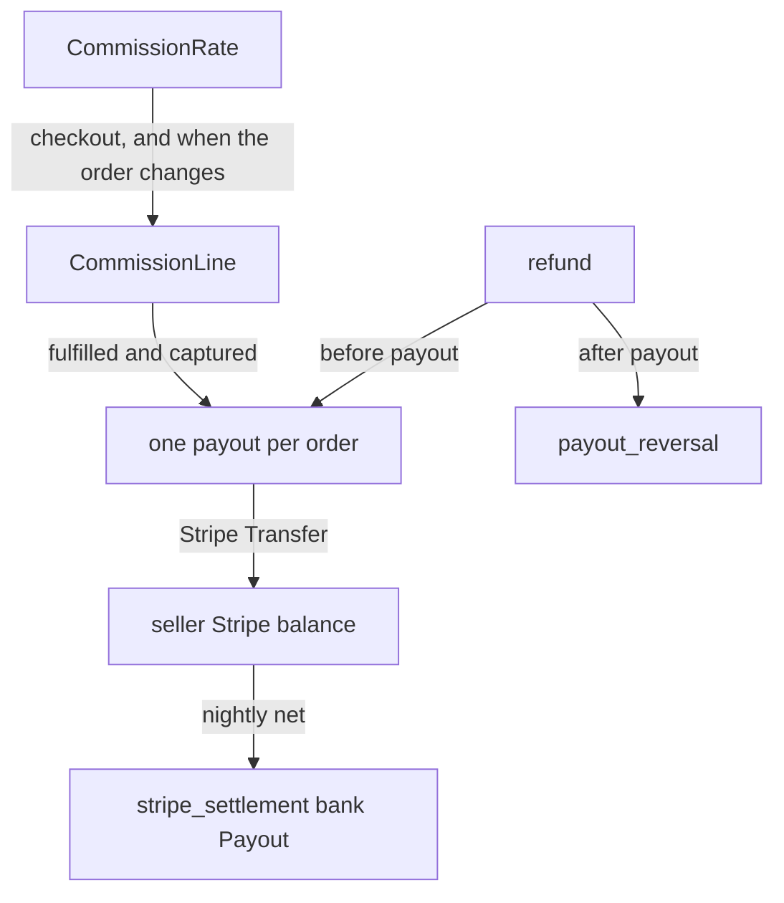

# Mercur — one seller per order; the platform keeps a commission and pays the rest

**Path:** `분석/정산/src/mercur`  
**Version:** `@mercurjs/core` 2.4.2-canary.1 (`ee812b0`, 2026-11-06)  
**License:** MIT  
**Stack:** Medusa 2, TypeScript, PostgreSQL

Medusa core has no seller ledger. Mercur adds commission and payout on top. It does not split one capture across several recipients. There is one seller order. The platform deducts its commission and sends the remainder to that seller.

The layers it covers are part of Revenue Sharing (the platform-fee rule) and Settlement & Payout. There is no double-entry ledger.

| Record | Mercur | Mutable? |
|--------|--------|----------|
| Rule | `CommissionRate` + `CommissionRule` | Yes. An existing line changes only when that order is refreshed |
| Commission line | `CommissionLine` | Yes. The same anchor is deleted and inserted again |
| Accrual | None. A ready order becomes a `payout` immediately | Only `on_hold` and `failed` are recalculated, and only before payout |
| Payout | One `payout` transfer per order. The bank batch is the Stripe plugin's `stripe_settlement` | `paid`, `processing`, and `aborted` are not decided again |

Models live in `packages/core/src/modules/commission/models/` and `packages/core/src/modules/payout/models/`. The amount functions are in `packages/core/src/workflows/payout/utils/payout-amounts.ts`.

---

## Rules

A `CommissionRate` is a percentage or a flat amount. A percentage multiplies `value` by the base. A flat amount is a per-currency `CommissionRateValue`; if that currency row is missing, the rate's `value` is used. When `include_tax` is on, the base is the line `subtotal` plus `tax_total`. The default is off. A set `currency_code` matches only orders in that currency. An empty code matches any currency.

A `CommissionRule` is a condition on a rate. `reference` is one of `product`, `product_type`, `product_collection`, `product_category`, `seller`. It is free text, so anything else never matches. The seller is not the product owner. It is the line offer's `seller_id`. The product catalog is shared and has no seller.

Matching is `SystemCommissionProvider`. Dimensions (`reference`) are AND. Rules inside one dimension are OR. The winning rate is the one with more dimensions. Equal dimension counts go to the older `created_at`. A rate with no rules matches every line and has dimension count 0, so a scoped rate beats it.

A boot loader creates one `is_default` rate. Name Default, code `default`, percentage 0, tax and shipping excluded, no rules. Shipping commission looks only at this default rate. When `include_shipping` is set, it writes one line per shipping method. A product rate does not apply to shipping.

Editing a rate leaves existing lines as they are. The next refresh of that order recomputes them with the rate at that moment.

---

## Commission lines

Checkout `completeCartWithSplitOrdersWorkflow` runs `refreshOrderCommissionLinesWorkflow` after the seller orders exist. The subscriber `order-commission-refresh-handler` runs the same workflow on `order-edit.confirmed`, `order.return_received`, `order.claim_created`, and `order.exchange_created`.

A line anchors to either an order line or a shipping method. A check constraint requires exactly one. The row copies the amount, the applied rate, the rate id, the rate code, and the provider. There is no unique index. `upsertCommissionLines` deletes the existing lines for the incoming anchors and inserts new ones, which is what keeps a single row. The computed result has no id, so an upsert on id would add a line on every refresh.

The delete covers only anchors written in this pass. If a line no longer matches any rate and drops out of the result, the old line stays. The docs warn about that case.

This line is the fee the platform takes. It is not a recipient row. The seller's claim is computed at payout time as `order total − commission sum`.

---

## Payout

A `payout` is one per order. `order_id` is unique. It belongs to a seller `payout_account`. Core has no schedule that calls this workflow. The Stripe connector plugin calls `createOrderPayoutsWorkflow` every five minutes, and also on fulfillment, cancel, capture, and refund. The default fulfillment bar is `fulfilled`.

The decision order is `decideOrderPayout`.

| Condition | Status |
|-----------|--------|
| Order canceled | `aborted` |
| No account, or payouts disabled | `on_hold` |
| Fulfillment below the bar | `on_hold` |
| No payment, or not captured yet | `on_hold` |
| Payment canceled, or fully refunded | `aborted` |
| `total − commission`, rounded to the currency minor unit, is ≤ 0 | `aborted` |
| Otherwise | `pending`, then sent to the provider in the same run |

A later run does not rewrite the amount of `paid`, `processing`, or `aborted`. Only `on_hold` and `failed` are decided again. If the account does not exist yet, no row is created. A later run creates it once the account exists.

The base is the pre-refund total minus amounts already refunded. Store-credit lines are not added back into that total. The seller does not receive that amount. Other credit lines are added back, because the refund already reduced the total, and then the refund sum subtracts them again. If the captured balance is smaller than that total, the captured balance is the cap. A refund that arrives before payout also reduces commission by the same ratio, and the refund id is stored in `absorbed_refund_ids`. A later reversal skips that id.

Sending is `processPayout`. It locks the row `FOR UPDATE`, sets `processing`, releases the lock, then calls the provider. The lock is not held across HTTP. Processable statuses are `pending` and `failed` only. An error with an unknown result stays `failed` and keeps the idempotency key. The next attempt uses the same key. If the provider answers that it refused, the key is cleared and the next attempt uses a new key. A final refusal is `aborted`. If the process dies after the row becomes `processing`, that row is not decided again. A separate retry workflow covers that.

The default `system` provider moves no money and returns `paid`. It is for local and tests.

---

## On Stripe, the transfer and the bank payout are two records

Plugin doc: `apps/docs/resources/integrations/stripe-connect/payouts-and-settlements.mdx`. Models: `packages/plugins/stripe-connector/src/modules/stripe-connector/models/`.

The moment a `payout` goes out, it is a Stripe Transfer. It moves from the platform balance to the seller's Stripe balance, with that order's charge as `source_transaction`. It does not wait for the seller balance to become available.

`stripe_settlement` is the next step. One per seller, currency, and period, every day at 01:03 UTC. The period sum is paid payouts − paid reversals + extra credit − subscription fee − extra invoice. A line points at a payout, a reversal, or an adjustment, and those three are unique across settlements. A net ≤ 0 is `aborted` and no money is sent. The lines stay. If the bank Payout fails or the balance is short, the next period is not opened.

An adjustment is money outside an order: subscription fee, extra invoice, extra credit. It is a different column from the order share.

---

## Refunds

A refund before payout reduces the payout amount. A refund after payout is one `payout_reversal`. `refund_id` is unique. The amount is `refund − commission sum × refund / order total`. It does not look at which line the commission came from. The reversal stays `on_hold` until the payout is `paid` and has a provider id. A full refund aborts the payout itself, so there is no reversal.

Commission lines are rewritten with the current rate when a return is received. A payout that is already `paid` does not change then. The lines and the money already sent can diverge.

---

## The order is split per seller

One cart has one payment session. `splitCapturedCartPaymentWorkflow` divides that capture in proportion to the seller-order amounts. `allocateProportionally` floors to the currency minor unit, then hands the remainder out one unit at a time, starting with the largest fractional part, so the parts sum to the capture. The number of payments does not grow with the number of sellers. The number of order rows does. An `order_group` ties those orders together.

There is no place to split a 10,000,000 KRW show into host 75, promoter 10, operator 5, platform 10. If the host is the only seller, the platform 10% is a commission line and the payout is 9,000,000 KRW. The promoter and the operator are not recipients.

---

## Take

- Keep the rule and this sale's commission line in different tables. Shipping is a different anchor from a product line.
- AND across dimensions, OR inside a dimension. That shape is enough when a Talket bundle's conditions look like this. The current decision still wins: priority is list order only. Do not import Mercur's dimension-count score.
- Allocate the remainder so the parts sum to the original amount. When cutting recipient shares by ratio, floor first, then hand out 1 minor unit at a time, as `allocateProportionally` does.
- A refund before payout changes the accrual amount. A refund after payout is a reversal row. Record the refund id already absorbed so the reversal does not subtract it again.
- A provider error with an unknown result is retried with the same idempotency key. Only a refusal gets a new key. Keep the transfer HTTP outside the row lock.
- Keep the per-order transfer and the bank-deposit batch as different records. A batch line points at the transfer or the reversal it came from. A net ≤ 0 is not sent, and the lines stay. A failure does not open the next period.
- Charges outside an order (subscription, extra cost, credit) are adjustments. They stay out of the product share.
- The first provider is `system`: it records only and closes as `paid`. Stripe is the next implementation.

## Leave

- Splitting the order per seller. Capture stays one per order. The split belongs on share rows.
- Recording only the platform commission and backing into the seller claim as `total − fee`. On Talket the platform is also a recipient row, and the shares on a line sum to that line's captured amount.
- Deleting and rewriting commission lines. An order edit recomputes a past sale with the current rate. A Talket share is written once at payment and is not edited.
- Skipping accrual and sending a per-order transfer as soon as the order is fulfilled. Ticket money would leave before session end or the claim deadline. `on_hold` means the account, the capture, or fulfillment is not ready yet. It is not that wait.
- Splitting a refund reversal by the order-wide commission ratio. A partial refund reverses only that line's shares.
- Removing store credit from the seller base. Amounts paid with points stay in the base.
- Making payout unique on `order_id` alone. The target is a line or a delivery fee, and each recipient has an accrual.
