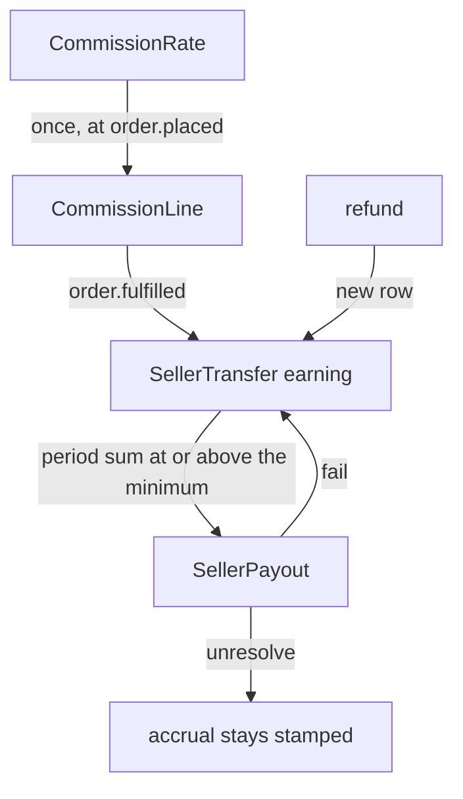

# Spree — freeze the platform fee, book the seller's debt at fulfillment, then batch it by period

**Path:** `spree/` (monorepo; the core is `spree/core`)  
**Version:** 6.0.0.alpha (`835e1ed43f`, 2026-09-10)  
**License:** BSD 3-Clause  
**Stack:** Ruby, Rails, PostgreSQL. The accrual unique key also has a generated column for MySQL and MariaDB

It does not split one capture across several recipients. There is one seller order. The platform subtracts its commission and records the remainder as a debt to that seller. There is no double-entry ledger. `SellerBalance` is not a table. It is the sum of accruals and payouts, counted per currency.

The layers it covers are part of Revenue Sharing (the platform fee) and Settlement & Payout.

| Record | Spree | Mutable? |
|--------|-------|----------|
| Rule | `CommissionRate` + `CommissionRule` | Yes. Only the next sale changes |
| Commission line | `CommissionLine` | No. Written once at placement |
| Accrual | `SellerTransfer` | No. A refund is a `refund_reversal` |
| Payout | `SellerPayout` | On failure, only the accrual's `payout_id` is released. `unresolved` does not release it |

Models: `spree/core/app/models/spree/commission_rate.rb`, `commission_line.rb`, `seller_transfer.rb`, `seller_payout.rb`. The service that writes lines is `spree/core/app/services/spree/commissions/commission_order.rb`. Accrual is created by `spree/core/app/subscribers/spree/seller_transfer_subscriber.rb` on `order.fulfilled`.

The `Fee` a buyer sees is not one of these four. It is added to the order total, like shipping or a payment fee. Commission is money between the platform and the seller, so `commission_total` is a cache outside the order total.

---

## Rules

A `CommissionRate` is a store list. `kind` is `percentage` or `fixed`. A percentage is from 0 through 100. A flat amount applies to a currency only when that currency has a `CommissionRateValue.amount`. It does not convert. A missing currency row falls through to the next rate. A percentage's floor and cap are also per-currency amounts. If that currency has no bound, the percentage is applied uncut. A flat rate cannot turn `include_shipping` on. Attaching the same flat amount to shipping would charge it twice on one sale.

A `CommissionRule` is a condition inside a rate, one per kind: `ProductRule`, `CategoryRule`, `SellerRule`, `ItemTotalRule`. A rate matches when every one of its rules matches. Several ids inside one rule are OR. An amount band looks at the line amount after discount. The minimum is inclusive and the maximum is exclusive, so adjacent bands do not overlap. A rate with no rules matches every sale. The list stops at the first match, so that rate has to sit at the bottom. Above the others, nothing below it is reached.

A new rate is inserted at the top of the list. Putting it at the bottom hides it under the default rate. There is no score that makes a product beat a category. Order is the priority. The seed inserts only the marketplace default and moves it to the bottom. Product, category, and seller slots stay empty. Editing a rate changes only the next sale. A rate is soft-deleted, and an existing line's `commission_rate_id` is not deleted with it.

The “product > seller > default” line in `docs/user/vendors/commission-rates.mdx` is not this list. It describes a different surface, the vendor profile and the product Platform Fee field. The developer docs and the model comments accept list order only.

---

## Commission lines

At `order.placed`, `CommissionOrder` writes the lines. If lines already exist, it does not recompute them. It only reconciles the order's commission-total cache. Unique indexes on the line-item id and the shipment id stop a replay from charging twice. The losing side returns the winning side's line.

This row is the fee the platform takes from that line. It is not a recipient split. The seller is the line's `seller_id` snapshot, not the product's current owner. A line with no seller is the marketplace's own product and has no commission. The row copies the amount, the tax, the tax rate, the applied rate, and the rate id. Commission VAT is a separate supply billed to the seller, so it is a different column from product VAT. The tax jurisdiction is the seller's bill-to, not the buyer.

The target is either an order line or a shipment. A shipping commission is written when a rate with `include_shipping` writes a line per shipment.

---

## Accrual

A `SellerTransfer` is one seller's debt on one order. The `order.fulfilled` subscriber creates it asynchronously, so the transfer HTTP is not inside the fulfillment transaction. A digital order is fulfilled immediately, so the accrual is immediate. If `order.seller_id` is missing, nothing is written.

The amount is that order's sales total minus the commission sum. It does not look at whether the buyer paid with store credit or a gift card. The seller's claim is not reduced by that tender. The platform covers it.

The kinds are `earning` and `refund_reversal` only. There is one earning per order. The unique key is `order_id` where `kind = 'earning'`. That key exists because the order was already split into a seller order. Using it unchanged on a line-level ledger rejects the second line of one order.

The status is not a state machine: `pending`, `processing`, `completed`, `failed`, `unresolved`. Only `pending` and `processing` can be sent again. `unresolved` means the payment provider could not say whether the money moved, so it is outside the retry set.

A refund adds a negative row. It does not edit the existing row. `refund_id` is unique. The amount is `refund amount × (earning / order total)`, and it does not go below zero past the sum already reversed. A full refund equals the full earning. It does not look at which line the commission came from. A reversal amount is negative, so sending that row as a seller transfer would pay money that should be taken back. The queue that goes out to a provider is earnings only.

---

## Payout

A `SellerPayout` is one transfer batch for one seller, one currency, and one period. The accruals it includes are `completed` and have no `payout_id`. A refund reversal that arrives after a payout has closed goes to the next period.

Sweep stops before bundling when the sum is ≤ 0 or below the seller's minimum payout. It does not send a negative payout. If another sweep takes some accruals first, the amount is added again, and the bundle is dropped if it has fallen under the minimum.

Deleting a payout leaves the accruals and releases only `payout_id`, so they are eligible next period. `fail!` releases that stamp too. If it is not released, the balance still shows the debt and sweep never picks the row up again. `unresolve!` deliberately does not release it. The provider idempotency key expires after about a day, so releasing the stamp and sending again next month would pay the same money twice.

Sending money is a `PayoutProvider`. The default `system` provider records only, and an operator makes the transfer. Stripe Connect is one implementation of that port. `transfer!` creates a Transfer to the connected account at accrual time, and `pay!` creates a bank Payout from that account. An amount of 0 is closed as `completed` without asking Stripe. `reverse!` marks the ledger `completed` and does not reverse the Transfer. The external id sits on both the accrual row and the payout row.

---

## The order is split per seller

`SplitBySeller` creates a seller order. The payment stays one on the group, and `AllocatePayments` divides the child-order amounts in the books. The number of captures does not grow with the number of sellers. The number of order rows does. That is why the accrual unique key is the order id.

There is no place to split a 10,000,000 KRW show into host 75, promoter 10, operator 5, platform 10. If the host is the only seller, the platform 10% is a commission line and the accrual at fulfillment is 9,000,000 KRW. The promoter and the operator are not recipients.

---

## Take

- Split rule, commission line, accrual, and payout into four records. The balance is their sum. There is no balance column.
- A rate can be edited. This sale's line is frozen at placement. If it already exists, it is not recomputed.
- First match in list order. A rate with no conditions sits at the bottom. A new rate is inserted at the top. Do not let dimension count decide the winner.
- Rules on one rate are AND. Targets inside one rule are OR. Amount bands exclude the maximum so adjacent bands do not overlap.
- A percentage's floor and cap are per-currency amounts. Do not add a percentage and a flat amount in one row and then cut the result.
- Commission VAT is a different column from product VAT. It is not added to the order total.
- A refund is a reversal row. The reversible amount is the original accrual minus the sum already reversed, and it does not go below zero.
- A failed payout releases only the batch link. `unresolved` keeps the link and is not sent again.
- A net ≤ 0, or a net below the minimum, is not bundled for that period. It nets against the next period.
- The first provider records only. The transfer HTTP stays outside the fulfillment transaction.
- Paying with store credit is not, by itself, a reason to reduce the seller's claim.

## Leave

- Splitting the order per seller. Capture stays one per order. The split belongs on share rows.
- Recording only the platform commission and backing into the seller claim as `sales − fee`. On Talket the platform is also a recipient row, and the shares on a line sum to that line's captured amount.
- Keying an accrual by order id. The unit is a line or a delivery fee, and there is one accrual per recipient.
- Splitting a refund reversal only by the order-wide ratio. A partial refund reverses only that line's shares.
- Using fulfillment as the accrual time. Issuing a ticket is fulfillment. The amount becomes payable after session end or the claim deadline.
- Closing the ledger the way Stripe `reverse!` does, without reversing the transfer. If Connect is used, the reversal is a separate call on that port.
