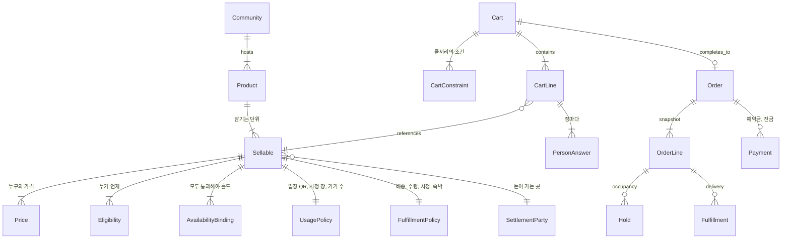

# 한 커머스로 묶기 v2

[한-커머스로-모으기.md](한-커머스로-모으기.md)의 뼈대 위에, 여행·푸드오더·팬덤·지역축제·오프라인 콘서트·버튜버 온라인 콘서트를 올린다. v1의 목표는 셔츠, 티켓, 호텔, 시간 예약이 같은 카트와 같은 결제를 타는 것이다. v2는 그 카트에 출발일, 메뉴, 멤버십, 시청권, 지정석, 응모가 함께 들어가는 경우다.

뼈대는 그대로다. 판매 단위(sellable)는 하나고, 가용성(availability)·자격(eligibility)·가격(price)·이행(fulfillment)·환불(refund)만 단위마다 갈린다. 상품 종류마다 테이블을 만들지 않는다.

말은 v1과 같다. [한-커머스로-모으기.md](한-커머스로-모으기.md) 앞의 표를 본다. 이 문서에서는 표와 소제목에 한 번씩 영어를 붙인다.

관련 노트: [여행.md](여행.md), [통합재고.md](통합재고.md), [직접입력-옵션.md](직접입력-옵션.md), [talket/README.md](talket/README.md).

---

## 1. 통합 대상

톡켓이 이미 가진 것: 입장권, 지정석 카테고리(좌석 메타 주소만), 멤버십, 굿즈, 배송, 바우처, 현장 수령, 투표, 사용(`ONCE`/`DAILY`), 파트너 구매 제한, 결제 없는 지급.

이번에 더한 것:

| 묶음 | 상품 | 장바구니에 담기는 것 |
|------|------|----------------------|
| 여행 | 패키지·자유여행·크루즈 | 출발일 하나. 성인·아동·유아는 그 출발일의 가격 |
| 여행 | 호텔·캠핑 | 숙박 구간 |
| 여행 | 항공 단독 | 공급사 검색 결과. 로컬 정원 없음 |
| 푸드 | 메뉴 | 메뉴 하나 + 옵션·요청 문구 |
| 푸드 | 테이블 | 시각과 인원에 맞는 빈 테이블 |
| 팬덤 | 팬클럽 멤버십 | 기간이 있는 자격. 다른 상품의 구매 조건 |
| 팬덤 | 디지털 구독 | 갱신되는 콘텐츠 권한. 선예매와 별개 |
| 팬덤 | 앨범·MD·선주문 | 버전·사이즈. 출고일이 미래일 수 있음 |
| 팬덤 | 랜덤 특전 | 결제 금액으로 지급 수가 정해지는 사후 지급 |
| 팬덤 | 현장 수령 | 굿즈 수량 + 수령 시간대 |
| 팬덤 | 영통·팬사인·선예매 응모 | 신청. 당첨 뒤에 정원 또는 결제 |
| 축제 | 일일권·회차 입장·무료 등록 | 날짜 또는 시간대의 정원 |
| 축제 | 체험·프로그램 | 세션 정원. 입장권과 별도 |
| 축제 | 부스 | 위치 × 기간. 구매자는 업체 |
| 축제 | 주차·셔틀·락커 | 시간대 정원 또는 대여 구간 |
| 축제 | 후원 | 금액. 리워드가 있을 때만 굿즈 재고 |
| 축제 | 자원봉사 | 포지션 인원. 판매 금액 없음 |
| 오프라인 콘서트 | 등급·스탠딩 | 회차의 정원 |
| 오프라인 콘서트 | 지정석 | 자리 행 |
| 오프라인 콘서트 | 사운드체크 | 입장권 구매자만 사는 작은 정원 |
| 오프라인 콘서트 | 현장 MD·응원봉 | 굿즈 수량. 입장 정원과 별도 |
| 온라인 콘서트 | 시청권 | 회차의 계정 권한 |
| 온라인 콘서트 | 다시보기·화질·각도·음성 | 같은 회차의 추가 권한 |
| 온라인 콘서트 | 슈퍼챗·디지털 응원 | 방송 중 금액 |
| 온라인 콘서트 | 극장 동시상영 | 상영관 좌석. 시청권과 별도 정원 |

한 주문의 예: 콘서트 지정석 두 장, 응원봉 현장 수령, 멤버십 할인가, 축제 먹거리, 원정 출발일. 결제는 하나다.

---

## 2. 공통으로 두는 것

v1의 여섯 겹(카탈로그 catalog, 제안 offer, 가용성 availability, 홀드 hold 와 확정 commit, 주문 order, 돈 payment, 이행 fulfillment)에 셋만 더한다. 자격(eligibility), 사람 답(person answer), 정산(settlement)이다.



| 겹 | 통합 규칙 |
|----|-----------|
| 커뮤니티(community) | 아티스트, 축제, 여행사, 매장. 카탈로그의 테넌트(tenant). 행사 id를 모든 판매 단위(sellable)에 강제하지 않는다 (v1) |
| 상품(product) | 이름, 일정 문구, 포함 내역, 메뉴 설명. 재고 키(stock key)가 아니다 |
| 판매 단위(sellable) | 출발일(departure), 회차×등급, 자리, 메뉴, 세션, 시청권(streaming entitlement), 멤버십 기간. 줄이 가리키는 id |
| 가격(price) | 같은 판매 단위에 여러 가격. 성인·아동·유아, 멤버십가·일반가, 싱글차지(single supplement), 옵션 가산. 가격을 나누려고 정원(capacity)을 복사하지 않는다 |
| 자격(eligibility) | 팬클럽, 지역, 선예매(presale) 창, 카드사, 구매 상한(purchase limit), 공연장 반경. 재고 검사 앞 |
| 가용성(availability) | 판매 단위에 전략(strategy)을 하나 이상 건다. 전부 통과해야 홀드(hold). 메뉴는 수량과 재료, 등급 지정석(reserved seat)은 쿼터(quota)와 자리 행 |
| 사람 답(person answer) | 여행자, 입장자 이름, 등번호, 동의서. 수량만큼. 주문 줄(order line) 공통 문구(수령인, 요청사항)와 칸이 다름 |
| 주문(order) | 헤더(header) 하나, 줄마다 판매 단위 스냅샷(snapshot) |
| 돈(payment) | 예약금(deposit)·잔금(balance)은 줄에 둔다. 이번 결제액(amount due now)은 그 합. 재고와 다른 시계 |
| 이행(fulfillment) | 배송, 수령 시간, 체크인(check-in), 시청, 객실 배정, 특전 지급 |
| 사용(usage) | QR 1회, 재입장, 시청 창, 기기 수. 굿즈 수령 QR과 입장 QR은 사용 정책이 다름 |
| 정산(settlement) | 주최, 아티스트, 부스, 여행사, 송출사. 캡처(capture)는 하나, 배분은 줄마다 |

톡켓에 대응하면 상품은 `Product`, 판매 단위는 `ProductOption`이다. 성인 가격과 아동 가격을 옵션 둘로 만들면 `totalCount`도 둘로 갈라진다. 연령은 가격 행으로 두고 정원은 판매 단위에 남긴다.

---

## 3. 가용성 전략

전략은 판매 단위에 하나 이상 건다. 홀드는 그 결합이 모두 성공할 때 남는다. 음식 재료와 외부 공급도 같은 목록의 한 칸이다.

| 전략(strategy) | 잠그는 것 | 해당 상품 |
|------|-----------|-----------|
| 수량(quantity) | SKU·옵션 재고 | 굿즈, 버전별 앨범, 응원봉, 메뉴 자체 수량 |
| 합산 쿼터(aggregate quota) | 용량(capacity) 하나. 가격 종류가 같이 씀 | 출발일 잔여석, 스탠딩, 일일권, 세션, 사운드체크, 수령 시간대, 주차 |
| 행 할당(row allocation) | 빈 행을 집어 감 | 지정석, 식당 테이블, 극장 좌석, 부스 위치 |
| 구간 점유(interval occupancy) | 겹치면 거절 | 호텔·캠핑 밤, 락커, 체험 시간 |
| 권한(entitlement) | 수량을 깎지 않음. 계정·기간·기기 | 시청권, 다시보기, 디지털 구독, 화질·음성 추가 |
| 없음(none) | 재고 검사 생략 | 후원, 슈퍼챗, 무제한 디지털 지급 |
| 외부(external) | 공급사 응답이 가용 | 항공 단독. 로컬 카운터를 만들지 않음 |
| 구성품(component) | 부모 수량이 아니라 재료·구성 | 키친 재료, 키트. 메뉴 여러 개가 재료 하나를 같이 씀 |

같은 전략을 쓰는 줄은 락 키 순서를 고정한다. v1의 Saleor처럼 재고 키 정렬 뒤 잠근다. 권한·없음·외부는 그 락에 넣지 않는다.

쿼터에 붙는 파라미터. 전략을 새로 만들지 않는다.

- **공유(shared pool).** 성인·아동·유아가 잔여석 하나를 같이 깎는다. 싱글차지(single supplement)는 돈을 더하고, 석을 더 잡으면 그때만 수량을 올리는 가격 규칙으로 둔다.
- **최소 확정(minimum to confirm).** 최소출발, 최소 인원. 남은 수와 별도인 판매 단위 상태(모객 중 / 확정).
- **블록(block).** 주최·스폰서·아티스트 몫. 판매 풀에서 미리 빼고, 반환(release) 시점이 관객 취소와 다르다.
- **판매 창(sales window).** 팬클럽 선예매(presale), 카드사, 일반. 같은 풀의 시작 시각과 자격. 창마다 정원을 복사하지 않는다.
- **구매 상한(purchase limit).** 계정·옵션·금액 구간. 위버스 포토카드는 종류마다 상한이 다르다.

랜덤 특전은 이 전략이 아니다. 결제 확정 뒤 지급 작업이 별도 수량 풀에서 버전을 집는다. 구매 화면의 옵션이 아니다.

---

## 4. 판매 방식

가용성과 별도로, 줄이 생기는 경로가 넷이다.

| 방식 | 재고를 잡는 때 | 예 |
|------|----------------|----|
| 구매(purchase) | 홀드(hold) 또는 결제 확정(commit) | 입장권, 굿즈, 출발일, 메뉴, 시청권 |
| 응모(application) | 당첨 확정 때. 그 전은 신청 행 | 영통, 팬사인, 선예매 코드 |
| 지급(issue) | 결제 없이 발행 | 무료 등록, 에어드롭, 당첨 무료 좌석 |
| 갱신(renewal) | 기간이 끝날 때 다음 구간을 발행 | 디지털 구독. 해지는 환불 정책과 다른 시계 |

응모를 구매 주문에 넣으면 낙첨자도 재고를 잡거나, 당첨 정원이 없다. 신청 문서와 주문 문서를 나눈다. 당첨되면 지급이거나, 그때 결제가 열리는 구매다.

---

## 5. 줄에 남는 것

모든 줄이 같은 모양이다.

- 판매 단위 id, 이름, 전략 키(policy key)와 파라미터(parameter)의 스냅샷(snapshot). 환불·사용은 이 스냅샷을 읽고, 이후 상품 수정은 이미 난 주문에 안 탄다
- 가격 수량(priced quantity)과 재고 수량(stock quantity). 성인 2명·아동 1명이면 가격은 두 종류이고 쿼터 수량은 3이다. 싱글차지는 돈만 더할 수 있다
- 이번 결제액(amount due now)과 나중 결제액. 예약금(deposit)과 잔금(balance)은 줄에 있다
- 옵션·문구. 재고 키에서 제외. 재료를 깎는 옵션만 구성품 전략으로 연결
- 사람 답(person answer). 수량이 3이면 입장자·여행자 3명. 지정석이면 사람마다 자리 행 id. 줄 공통 문구(수령인, 요청사항)는 하나
- 자격 스냅샷. 어떤 멤버십·창으로 이 가격이 열렸는지
- 이행 묶음(fulfillment group) id, 정산(settlement) 대상. 위탁(consignment) 상품은 다른 굿즈와 다른 묶음이다

직접 입력은 [직접입력-옵션.md](직접입력-옵션.md)의 결론을 따른다. 줄에 하나면 구매폼으로 충분하다. 장마다 다르면 사람 답이다. 번호 개수가 재고면 그 번호가 판매 단위다.

톡켓 구매폼은 주문 줄의 `orderLineId`에 붙고, 같은 폼을 한 줄에 두 번 받지 않는다. 사람 답을 폼 반복으로 바꾸려면 그 저장 규칙이 먼저 바뀐다.

---

## 6. 한 주문이 지나는 순서

v1의 요청 순서를 유지한다. 락을 잡은 채 결제사·항공사·송출 상태 조회를 하지 않는다.

```
대기열(waiting queue). 드롭·선예매만
  → 줄 자격(eligibility). 멤버십, 지역, 창, 상한
  → 장바구니 제약(cart constraint). 사운드체크는 같은 주문의 입장권 또는 보유 입장권. 겹치는 온라인 패스는 경고만
  → 줄마다 가용성(availability) 결합
  → 로컬 홀드(local hold)는 한 트랜잭션, 락(lock) 키 정렬
  → 커밋(commit) 후 외부 홀드(external hold). 항공, 송출 좌석. 실패하면 보상(compensation)으로 로컬 홀드 해제(release)
  → 커밋 후 결제. 금액은 줄의 이번 결제액(amount due now) 합
  → 확정(commit)
  → 이행(fulfillment). 배송 묶음, 수령, 시청 창, 특전 추첨, 객실 배정
  → 사용(usage) 시점의 검사. QR 1회, 기기 수. 구매 홀드와 다른 명령
```

하나라도 로컬 홀드가 실패하면 그 주문의 로컬 홀드를 풀어 준다. 외부 홀드는 DB 롤백이 아니라 취소 호출이다. 멱등 키는 주문 줄 id다.

잔금 기한이 지나면 그 줄의 홀드만 정책대로 푼다. 같은 주문의 굿즈 줄은 그대로다.

수령 시간대에 정원이 있으면 그 시간대는 판매 단위(쿼터)다. 정원 없는 희망 시각은 줄 속성이다.

---

## 7. 환불·변경·사용

환불 정책은 판매 단위에 둔다. 톡켓 기본값 `NO_REFUND`를 전 상품에 쓰지 않는다.

| 상황 | 재고 | 돈 |
|------|------|-----|
| 관객이 입장권을 일수 규칙으로 취소 | 쿼터·자리 반환 | 수수료 공제 |
| 공연 취소 | 전원 반환 | 전액 |
| 공연 연기 | 자리를 유지한 채 환불 창 | 창 안에서만 전액 |
| 송출 실패 | 자리 없음 | 전액, 또는 다시보기 연장으로 권한만 수정 |
| 조리 전 메뉴 취소 | 수량·재료 반환 | 전액에 가깝게 |
| 출발일 취소 | 잔여석 반환. 최소출발 상태 재계산 | 여행 약관의 일수 수수료 |
| 슈퍼챗·랜덤 특전 | 특전 미지급분 반환 | 정책에 포함 여부를 줄에 스냅샷 |
| 구독 해지 | 다음 구간을 발행하지 않음 | 사용 기간의 환불 규칙 |

운영 변경(호텔명 확정, 타임테이블, 우천 순연)은 카탈로그를 고친다. 이미 발행한 권한·자리는 이행 문서를 고친다. 잔여석을 다시 깎지 않는다.

사용 정책은 이행 물건마다다. 입장 QR 1회, 재입장 허용, 수령 QR, 시청 창, 기기 수. 한 `ProductUsage`를 공유하면 수령과 입장이 같이 소진된다.

---

## 8. 정산

이번 캡처는 주문에 하나이고, 금액은 줄의 이번 결제액 합이다. 배분 규칙은 줄마다다. 줄 하나만 환불하면 그 줄의 `release`와 부분 환불만 돈다. 테이블로 어떻게 나눌지는 [정산/README.md](정산/README.md)다.

- 입장권·시청권: 주최, 아티스트, 플랫폼, 송출사
- 부스·먹거리: 업체. 주최 수수료
- 여행: 여행사와 지상 공급사
- 위탁 MD: 위탁사. 합배송 금지도 이 줄의 이행 속성
- 후원: 수령 주체

정산 실패가 재고 커밋을 되돌리지는 않는다. v1에서 돈과 재고의 시계를 나눈 것과 같다.

---

## 9. 톡켓에서 비는 자리

| 이미 있는 자리 | v2에서 쓰는 법 | 빈 자리 |
|----------------|----------------|---------|
| `Product` / `ProductOption` | 상품 / 판매 단위 | 가격 종류가 옵션이 되면 정원이 갈라짐 |
| `totalCount` 합산 | 쿼터 전략 | 판매 창·블록·최소 확정이 없음. 옵션끼리 풀을 공유하지 않음 |
| 지정석 카테고리, `seatMetaUrl` | 전시 | 자리 행 락이 없음 |
| 파트너 제한 | 자격의 한 종류 | 멤버십·지역·선예매 창·계정 상한 |
| 구매폼, 줄당 하나 | 줄 공통 문구 | 사람마다의 답. 같은 `formId` 두 번은 거절 |
| `ProductUsage` `ONCE`/`DAILY` | 입장·바우처 | 시청 창, 기기 수, 수령과 입장의 분리 |
| `CreateProductBundle` | 생성 묶음 | 구성품·재료를 깎지 않음 |
| 결제 확정 한 번 | 잔금 없는 상품 | 예약금·잔금·구독 갱신 |
| `NO_REFUND` / `GENERAL` | 상품 하나의 환불 | 줄마다의 일수 수수료, 연기 유지, 송출 실패 |
| 주문 하나, 줄 여러 개 | 혼합 카트 | 줄마다 다른 락 키와 정산 대상 |
| 에어드롭 | 지급 | 응모 문서가 없음 |

---

## 10. 넣지 않을 것

- 상품군마다 주문 테이블을 만드는 것. FastBooking이 모듈마다 재고 테이블을 나눈 반례가 v1에 있다.
- 테넌트에 판매 패턴을 하나만 고정하는 것. 한 축제 주문에 입장권과 메뉴가 섞여야 한다.
- 선예매 창마다, 연령마다, 멤버십가마다 판매 단위를 복제하는 것. 복제하면 공유 풀이 깨진다.
- 응모 신청을 주문 줄로 넣어 낙첨 전까지 재고를 잡는 것.
- 랜덤 특전 버전을 구매 옵션으로 만들어 고객이 고르게 하는 것.
- 시청권을 공연장 쿼터에 합산하는 것. 동시상영 좌석만 별도 행 할당이다.
- 항공 응답을 로컬 `totalCount`로 캐시해 그 숫자를 잠그는 것.
- 입장 사용과 수령 사용을 같은 1회 소진으로 두는 것.
- `NftCategory`에 `TRAVEL`, `FOOD`, `CONCERT`를 넣고 결제·환불·입장 코드가 `switch`로 갈라지게 하는 것. 카테고리는 전시·검색 라벨로 남긴다.

---

## 11. 리뷰에서 고친 것

초고는 방향은 맞았다. 판매 단위를 하나 두고 전략만 나누는 뼈대, 응모와 구매의 분리, 랜덤 특전을 옵션으로 두지 않는 것, 시청권과 공연장 석을 합치지 않는 것은 유지한다. 구현에 들어가면 깨지는 결정은 고쳐 두었다.

| 초고 | 문제 | 지금 결정 |
|------|------|-----------|
| 판매 단위당 가용성 하나 | 메뉴는 품절 수량과 재료를 같이 보고, 등급 지정석은 등급 정원과 자리 행을 같이 잠근다 | 전략은 목록이다. 전부 성공해야 홀드 |
| 결제 일정이 주문 헤더 | 같은 주문에 출발일 예약금과 응원봉 전액이 있다 | 이번 결제액·잔금은 줄에 두고, 캡처는 그 합 |
| 자격은 판매 단위만 | 사운드체크는 같은 카트의 입장권, 멤버십가는 보유 멤버십을 본다 | 줄 자격 다음에 장바구니 제약을 둔다. 겹치는 온라인 패스는 거절이 아니라 경고 |
| 홀드 실패는 DB 롤백 | 항공 확정은 트랜잭션 밖이다 | 로컬 홀드와 외부 홀드를 나누고, 외부 실패는 취소 호출로 보상 |
| 사용 규칙을 구매 때 검사 | 기기 수와 QR 1회는 입장·시청 시각의 일이다 | 구매는 권한 행을 만들고, 사용은 나중 명령 |
| 수령 시간대 | 정원이 있는 슬롯과 희망 시각이 한 말로 섞였다 | 정원이 있으면 쿼터 판매 단위. 없으면 줄 속성 |
| 수량 하나 | 성인 2·아동 1의 가격과 잔여석 3이 다르다 | 가격 수량과 재고 수량을 줄에 따로 둔다 |
| 정책은 상품을 다시 읽음 | 환불 규정을 나중에 바꾸면 이미 난 주문까지 바뀐다 | 전략 키와 파라미터를 줄에 스냅샷 |

아직 범위 밖에 둔 것. 첫 구현의 전제가 아니다.

- 대기열의 공정성(봇, 동시 입장 순번). 드롭 상품을 팔기 전에 포트로 붙이면 된다.
- 나란한 좌석. 행 할당 전략의 파라미터로 두고, 등급 쿼터만 있을 때는 요구하지 않는다.
- 아동 나이의 기준일. 구매일인지 출발일인지 공연일인지. 가격 종류의 입력으로 두고 전략을 새로 만들지 않는다.
- 사업자 계산서. 구매자 종류(개인·사업자)이지 주문 종류가 아니다.
- 최소출발 재계산. 한 주문의 환불 락 안에서 끝내지 않는다. 그 판매 단위의 확정 주문 합으로 나중에 상태를 고친다.
- 커뮤니티가 다른 줄의 한 카트. 정산·권한이 줄의 커뮤니티를 따른다는 전제로 허용한다. 결제를 판매자마다 나누는 요구가 생기면 캡처를 나눈다.

---

## 12. 구현 전략

한 번에 전략 여덟 개와 상품군(product family) 전부를 넣지 않는다. 커널(kernel)을 먼저 고정하고, 상품군은 그 커널이 부르는 포트(port)로만 들어온다. 지금 톡켓 상품의 동작은 포트를 추출한 뒤에도 같아야 한다.

### 커널(kernel)

주문 파이프라인이 아는 것은 줄, 돈, 홀드 행, 포트 키다. 콘서트·여행·메뉴를 import하지 않는다.

```
EligibilityPort.evaluate(line, buyer)
CartConstraintPort.evaluate(cart)     // 등록된 제약만. 없으면 통과
AvailabilityPort.hold / commit / release
UsagePort.grant / consume / revoke    // 구매와 다른 시점
RefundPort.quote(line snapshot)       // 수수료 계산. 재고 반환은 AvailabilityPort.release
FulfillmentPort.open(group)
```

홀드 행은 `(policyKey, subjectId, quantity | interval, state)`다. 자리·재료·항공 PNR은 `subjectId` 너머의 테이블이고, 그 테이블은 해당 모듈 소유다. `t_order`에 좌석 번호·항공편·메뉴 옵션 컬럼을 추가하지 않는다.

포트 키는 `quota.v1`처럼 버전을 붙인다. 동작을 바꿀 때는 v2 키를 등록하고, 이미 스냅샷된 줄은 v1 구현이 처리한다. v1 구현을 지우는 시점은 그 키를 가진 주문이 없을 때다.

모르는 키는 그 줄을 실패시킨다. 기본 전략으로 떨어뜨리지 않는다. 새 모듈을 배포하지 않은 채 상품만 키를 바꾸면 판매가 멈추고, 잘못된 재고 전략으로 팔리지는 않는다.

### 상품군 코드를 두는 자리

상품군은 주문 클래스가 아니다. 포트 구현과 파라미터 스키마와, 필요할 때만 관리 화면이다.

```
packages/trade          파이프라인, 홀드 행, 스냅샷. 상품군 이름 없음
packages/availability   quota.v1 (오늘의 totalCount)
modules/seat-row        availability:seat-row.v1, 자리 테이블, 좌석 맵 화면
modules/travel-departure  quota 파라미터(최소출발, 연령 가격), 일정 편집 화면
modules/kitchen         component.v1, 재료 테이블
```

새 상품의 순서는 이렇다.

1. 기존 포트와 파라미터로 되는지 본다. 선예매 창, 멤버십가, 연령 가격, 최소출발, 구매 상한은 `quota.v1`의 파라미터와 자격 포트다. 모듈을 새로 만들지 않는다.
2. 안 되면 포트 구현을 하나 추가한다. 그 모듈은 커널 인터페이스만 의존한다.
3. 판매 단위 저장은 포트 키와 파라미터 JSON이다. 카테고리 enum은 목록 필터용으로 남겨 둔다.

커스텀이 새는 자리만 허용한다.

| 허용 | 금지 |
|------|------|
| 포트 구현 안 | `CompleteNftTradePaymentCommandProcessor` 안의 `if (category === 'TRAVEL')` |
| 파라미터 스키마와 그 스키마로 그리는 관리 폼 | `t_order` / `t_order_line`에 상품군 컬럼 |
| 좌석 맵, 달력, 메뉴 편집처럼 스키마로 안 그려지는 화면. 저장은 같은 판매 단위·파라미터 | 환불 코드가 상품 테이블을 다시 읽어 수수료를 계산 |
| 커밋 후 아웃박스 (메일, 정산 내보내기, 항공 확정) | 재고 락 안의 외부 HTTP |

장바구니 제약도 같은 방식이다. `requires-sellable-in-cart`, `requires-entitlement`처럼 키가 있고, 사운드체크 상품은 그 키를 데이터로 가리킨다. 콘서트 모듈이 주문 전체를 읽어 특수 처리하지 않는다.

관리 화면은 파라미터 JSON 스키마로 그린다. 상품군마다 주문 상세를 포크하지 않는다. 좌석 맵만 커스텀 컴포넌트다.

### 단계

각 단계가 끝나면 기존 티켓·굿즈 구매는 지금과 같아야 한다. 기존 상품은 암묵적으로 `quota.v1` + 파트너 자격 + `ONCE` 사용 + 스냅샷된 `NO_REFUND`다.

| 단계 | 넣는 것 | 아직 안 넣는 것 | 끝나는 기준 |
|------|---------|-----------------|-------------|
| 0 | 결제 확정의 재고 검사를 `AvailabilityPort` 뒤로 이동. 구현은 오늘의 `totalCount` 합 | 새 상품, 새 테이블 | 기존 주문 테스트가 통과. 프로세서에 카테고리 분기가 없음 |
| 1 | 판매 단위에 가격 행 여러 개. 재고 수량은 하나 | 사람마다의 답 | 멤버십가·일반가, 성인·아동이 같은 정원을 씀 |
| 2 | 자격 포트. 파트너 제한을 첫 구현으로 이전. 판매 창·계정 상한은 그다음 구현 | 장바구니 제약의 특수 케이스 | 선예매가 풀을 복사하지 않음 |
| 3 | 사람 답. 구매폼의 줄당 하나 제한을 사람 수만큼 허용하는 저장 | 좌석 행 | 입장자 이름이 수량만큼 남음 |
| 4 | 사용 포트를 구매와 분리. 입장과 수령이 다른 자격 증명 | 시청 기기 수 구현 | 수령 QR을 찍어도 입장이 남음 |
| 5 | 줄의 이번 결제액. 캡처는 합 | 구독 갱신 | 한 주문에 예약금 줄과 전액 줄 |
| 6 | 첫 번째 새 가용성. 실제로 팔 상품이 정하는 하나. 지정석이면 `seat-row.v1`, 숙박이면 구간 | 나머지 전략 | 그 상품의 홀드·해제·멱등만 |
| 7 | 응모 문서. 당첨이 지급 또는 구매를 만듦 | 항공 외부 홀드 | 낙첨 신청이 정원을 안 잡음 |
| 8 | 외부 홀드와 보상. 아웃박스 | 대기열 공정성 | 항공 실패 시 로컬 홀드가 풀림 |

6단계의 순서는 사업이 고른다. 코드 구조는 그 선택과 무관하게 5단계까지 같다. 재료 재고, 구독, 대기열, 동시상영은 8 이후에도 포트 추가로 들어온다.

### 바뀌어도 되는 것

파라미터 필드 추가는 기본값이 있을 때만 한다. 스키마에 optional로 넣고, 스냅샷에 없으면 그 기본값으로 읽는다. 필드 삭제와 의미 변경은 새 포트 키다.

상품군 모듈을 빼도 커널은 빌드된다. 그 키를 쓰는 상품은 판매가 막히고, 다른 상품은 남는다.

테스트는 둘로 나눈다. 커널은 가짜 포트로 파이프라인(정렬 락, 일부 실패 시 해제, 스냅샷 환불, 부분 환불)만 본다. 모듈은 자기 포트의 홀드·해제·멱등만 본다. 콘서트 테스트를 주문 저장 전체에 걸지 않는다.

톡켓 테이블에서의 순서, 백필, 읽기 전환은 [한-커머스로-모으기-v3.md](한-커머스로-모으기-v3.md)다.
